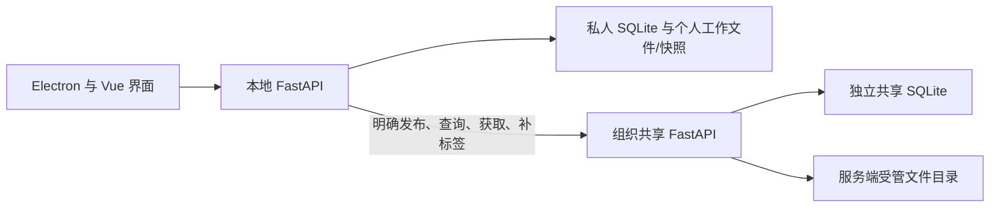

# TeamHub MVP 实施蓝图

> 以可验证的核心流程为主线，复用现有工程中的有效成果，重建资料发布、版本保存和组织共享的可靠性。

> **历史规划提示（2026-10-05）：** 本文保留初始 M0—M7 设计，默认复制收录、恢复历史新增版本等部分规则已由后续[项目基石](TeamHub项目基石.md)替代。新的云端网页、指定成员共享和独立资料投递以[云端与资料投递实施蓝图](云端与资料投递实施蓝图.md)的 C0—C7 为实施安排，不能把本文当作当前全部行为的定义。

| 文档信息 | 内容 |
| --- | --- |
| 编号 / 版本 | TH-MVP-PLAN / v0.1 |
| 建立 / 更新日期 | 2026-09-23 / 2026-09-23 |
| 上位依据 | [TeamHub 项目基石](TeamHub项目基石.md)，以其中已确认原则为约束 |
| 代码观察基线 | Git `9921c00`；包括此前运行核查与本轮只读源码复核，二者在 §6.1 分开标记 |
| 本文用途 | 下一步代码工程的任务拆解、实现约束、验证与交接依据 |
| 当前完成状态 | 规划文件已形成；本文中的目标目录、接口、测试和修复均不表示已经实现 |
| 交付边界 | 先在发起人的电脑上完成隔离的多账号模拟，再准备约 10 人的内网试用 |

**文档关系：** 基石说明项目为什么做、服务谁、坚持哪些边界；本蓝图说明首版如何实现和验证。产品原则冲突以基石中的最新明确决定为准；旧 README、旧代码的默认行为不能覆盖已确认原则。

**状态约定：** “已确认”来自发起人明确意见；“工程默认”是本方案为使任务可执行而提出的实现选择，可以在不改变产品原则的前提下根据验证结果调整，不能倒写成发起人逐项确认。工程默认的改变要记录原因、影响任务和验收用例，无需为每个普通实现细节另设审批。

## 导航

- [1. 能力与交付目标](#mvp-capability)
- [2. 固定约束与业务规则](#mvp-constraints)
- [3. 实现契约](#mvp-contract)
- [4. 首版不承担的工作](#mvp-nongoals)
- [5. 工程默认与待补充信息](#mvp-open)
- [6. 工程任务、验证与交接](#mvp-delivery)

<a id="mvp-capability"></a>

## 1. 能力与交付目标

### 1.1 一句话定义

让电力行业使用者在本地整理自己的文件、文件夹和压缩包，通过自由标签或名称找到资料；主动发布后，其他获授权成员可以发现、取用、补充标签和提交新版本，组织能够持续保留资料及其历史。

首版同时验证个人管理的价值与共同整理的价值，不把“上传成功”单独视为 MVP 完成。

### 1.2 首版必须跑通的用户流程

| 能力 | 初版行为 | 成功的具体表现 |
| --- | --- | --- |
| 个人收录 | 收录文件、压缩包或整个文件夹；默认复制纳管，保留原始来源；自由添加标签 | 不要求登录共享服务也能管理本地资料；私人资料不上传 |
| 查重 | 个人库及当前有权访问的共享库分别查重 | 相同内容给出现有资料和匹配版本的入口，不自动删除、覆盖或归并来源文件 |
| 查找 | 标签组合及标签关键词联想、名称关键词及名称联想两条入口；目录浏览和基本收藏辅助回找 | 非原始整理者可以沿自己的线索找到并打开资料 |
| 主动共享 | 用户选择目标资料并确认随同公开的标签 | 发布完整内容后才在共享搜索中出现 |
| 共同维护 | 成员对共享资料直接增加标签；修改、移除有最小权限限制 | B 增加的标签可被 C 搜索，且不泄露 B 的私人资料 |
| 版本管理 | 在原资料上提交新版本或明确另建资料；显示当前版及历史 | 同一资料的标签持续积累，各版内容可分别取回，更新不改写历史 |
| 文件夹管理 | 文件夹整体形成快照、整体共享、整体更新与取用 | 内部结构可复原；不把内部文件变成独立协同对象 |
| 组织保留 | 本地副本与共享副本独立；管理员控制共享资料的永久删除 | 本地删除、退出登录或成员停用不使共享资料消失 |

**本蓝图的范围取舍：** 基本收藏纳入首版，只有收藏、取消、列表；不做收藏夹树、排名或推荐。标签关键词联想复用现有实现，共现联想以简单查询和有限候选实现；如验证显示成本过高，可以延期共现联想，但需记录依据，不影响基本组合筛选。压缩包作为普通文件管理，不自动解析其中内容。

### 1.3 用一组场景贯穿开发

准备 A、B、C 三个成员和一名管理员，使用彼此隔离的个人资料库及同一测试共享空间。另建一个无访问权的测试空间，用于验证隔离，不因此扩展多组织管理界面。

1. A 收录 X，补充三个自由标签，保留另一份私人资料 P。
2. A 主动发布 X；B 按已有线索找到 X，取回指定版本。
3. B 在共享 X 上新增两个标签；C 通过新增线索找到同一个 X。
4. B 修改自己的副本，向 X 提交新版本；A、C 能辨识当前版，也能取回初版。
5. A 删除本地 X，随后停用 A 的共享账号；B、C 仍能使用共享 X。
6. 全过程 P 及其名称、标签、哈希命中、数量均不向其他成员暴露。
7. 把 X 换成含子目录、空目录、中文名称的文件夹，重复共享和更新过程。

这组流程是工程验收用例；“自由标签是否实际降低工作成本”仍需后续真实任务试用验证。

<a id="mvp-constraints"></a>

## 2. 固定约束与业务规则

### 2.1 不可破坏的产品约束

| 编号 | 约束 | 来源 / 状态 |
| --- | --- | --- |
| R-01 | 个人管理与组织共享并行；共享不是使用个人功能的前提 | 基石 §1、§3，已确认 |
| R-02 | 默认私有，只有明确的发布动作才能产生共享内容 | 基石 §6，已确认 |
| R-03 | 共享资料的标签对同一共享范围可见；同名标签不能扩张私人资料的可见范围 | 基石 §6.2，已确认 |
| R-04 | 自由添加标签；不强制行业分类树，也不等于任意修改、删除他人贡献 | 基石 §4、§7，已确认方向；具体矩阵见 §3.4 工程默认 |
| R-05 | 内容哈希用于查重和校验；资料身份及版本延续关系单独保存 | 基石 §8，已确认 |
| R-06 | “覆盖共享资料”是追加版本，旧版本保持可取回 | 基石 §8，已确认 |
| R-07 | 文件夹是整体快照，不实施内部文件的独立版本协作 | 基石 §1、§10，已确认 |
| R-08 | 本地删除、移动、改名或清理不能触发组织共享内容的删除 | 基石 §7.1，已确认 |
| R-09 | 共享资料永久删除由组织管理员控制；成员离开后资料保留 | 基石 §7，已确认 |
| R-10 | 其他成员可以提交新版本，并留下版本记录 | 基石 §7.3，已确认 |
| R-11 | 共享不绑定公有云；先本机隔离模拟，再内网部署 | 基石 §9，已确认 |
| R-12 | 查找目标是找到资料，不要求唯一命中；示例数字不是性能或业务指标 | 基石 §4、§11，已确认 |

### 2.2 为落实约束而采用的工程规则

以下是本蓝图的默认实现，不扩大为新的产品承诺：

- 资料 ID、版本 ID、内容摘要是不同概念；改名、改目录、补标签不产生内容版本。
- 版本指向不可变的受管内容快照，不直接指向可被办公软件改写的工作文件。
- 本地工作文件修改后显示“有未保存的修改”；用户保存版本或发布时创建快照，不后台自动共享。
- 成功提交的新版本成为该资料的当前版本；初版采用一条线性历史，不做审批或分支合并。
- 每次提交携带用户基于的当前版本 ID；若已过期则提示冲突，由用户重新查看和提交，不静默覆盖。
- 标签挂在持续存在的资料对象上，更新内容不清空标签；普通成员只新增或撤销自己添加的关联，管理员可移除其他关联。
- 首次发布明确携带选定标签；后续内容版本提交默认不替换共享标签集合。共享标签的变更走独立的关联增删动作，避免覆盖其他成员的贡献。
- 共享空间内查重不跨越权限边界；无权访问的内容不能通过搜索、联想、计数、哈希查重或下载接口被发现。
- 请求失败、断网或重试不能产生可见但无内容的资料、重复版本，或把本地副本标为已发布。
- 共享发布、版本提交、标签变更、管理员删除保留必要的操作者和时间记录；不因此建设用户行为追踪或贡献排名。

<a id="mvp-contract"></a>

## 3. 实现契约

### 3.1 总体结构与技术默认

**路线：保留现有工程及主要技术栈；选择性复用模块，完整替换不可靠的核心用例。** 不另起一套重复的前后端项目，也不要求保留旧接口或字段的全部行为。



| 层次 | 初版默认 | 取舍与约束 |
| --- | --- | --- |
| 桌面与界面 | Electron、Vue 3、Element Plus、Pinia | 保留已有文件交互与组件；更新受支持依赖，验证生产打包，不能只测 Vite 开发模式 |
| 个人服务 | 本地 FastAPI / Python，绑定回环地址 | 独立负责个人资料、快照与桌面共享请求；切库需重建数据库绑定 |
| 个人数据库 | 每个个人库独立 SQLite | 先解析配置再建立连接；库切换完成后不能继续使用旧会话 |
| 组织共享服务 | 保留 `cloud_backend` 作为部署单元，收敛为单体 FastAPI 服务 | 目录名称暂不更改；收敛已有 workspace 模型，不再同时维护设备 manifest 资料库 |
| 共享数据库 | 单进程服务使用独立 SQLite，文件放服务端本地磁盘 | 本机及首轮小规模内网试用默认相同方案；客户端只经 API 访问，不直接打开网络盘数据库 |
| 共享文件存储 | 组织服务控制的独立文件目录，提供经鉴权的流式上传、下载 | 不要求 MinIO、阿里云 OSS 或外部服务；只实现这一条初版存储路径 |
| 账号与共享范围 | 一个试用组织、一个共享空间，管理员预置成员 | 复用身份与成员关系基础；不把公开注册、组织发现、加入审批列为首版前提 |
| 请求与认证 | 桌面 UI 统一通过本地服务访问共享能力 | 本地服务是共享会话的唯一管理者；去掉桌面 UI 直连共享 API 与本地代理并存的分歧 |

选择共享 SQLite 是为了缩小初版部署成本，不承诺任意并发；事务要短，上传过程不能持有写锁。若验证显示持续写锁等待影响使用，单独记录迁移 PostgreSQL 的依据和任务。已有 PostgreSQL 配置与对象存储适配代码可以保留在仓库，但不作为首版必须维护、测试的多套运行路径。

共享 SQLite 启用外键约束、WAL 与有限的写锁等待；锁等待超限必须给出明确错误，不无限重试。M4 的并发提交测试验证事务条件更新和失败结果，不把“单进程”误当成不会出现并发请求。

**存储边界必须真实独立：** 本机模拟也使用不同数据根目录，不让“共享内容”只是指向个人原文件的路径或符号链接。将来迁移到内网服务器，迁移的是共享服务、数据库和受管内容，不携带私人库。

### 3.2 资料、版本和副本

| 概念 | 必需信息与关系 | 对旧实现的处理 |
| --- | --- | --- |
| 个人资料 | 稳定本地 ID、名称、类型、状态、工作位置、当前本地版本、标签 | 保留 `Document` 骨架；复制收录为默认，不默默移动或删除来源 |
| 组织资料 | 服务端生成的稳定 ID、共享范围、名称、当前版本、贡献来源 | 保留 `CloudDocument` 概念；取消必须与个人 ID 相同的假设 |
| 内容版本 | 版本 ID、资料 ID、单调版本号、内容摘要、大小、不可变存储键、作者、时间、说明 | 保留 Version 关系，重写内容落盘；版本号唯一约束由数据库保证 |
| 个人与共享关联 | 本地资料 ID、服务端标识、空间 ID、共享资料 ID、基于的共享版本 ID | 本地一份资料首版最多关联一个共享资料；不同人的本地 ID 可不同 |
| 标签关联 | 资料 ID、标签 ID、添加者、时间 | 共享关联增加贡献来源；名称自由，唯一性限定在当前个人库或共享空间 |
| 收藏 | 用户本地的资料引用；共享收藏保存服务器/空间/资料 ID | 收藏不上传私人标签，不复制共享内容；失去访问权时提示不可用，不绕过鉴权 |
| 发布请求 | 请求 ID、操作者、目标范围、目标资料/基准版本、状态、结果 | 支持幂等重试；服务端记录是最终结果依据 |

**数据库层最低约束：** `(document_id, version_number)` 唯一；资料上的当前版本 ID 为单一事实来源，旧 `is_current` 标志迁移后不得独立写入；标签关联不重复；当前版本和历史版本都属于对应资料及空间。共享版本作者不能只用文档的最后上传者代替，成员停用后贡献记录仍可辨认。

发布请求按“操作者、空间、请求 ID”唯一，并绑定请求内容摘要。版本历史的内容哈希不设唯一约束，因为恢复历史内容也可以形成新的提交记录。

是否增加独立“内容对象”表由实现复杂度决定。首版可以使用不可变存储键和明确引用查询；不能为了省表直接覆写历史内容，也不能为未来扩展先建立通用内容平台。

#### 3.2.1 动作与身份变化

| 用户动作 | 资料 ID | 版本与共享行为 |
| --- | --- | --- |
| 改名、改目录、补标签 | 不变 | 不新增内容版本，不自动发布 |
| 编辑工作文件 | 不变 | 旧快照不变；标记待保存的修改 |
| 保存新版本 | 不变 | 对稳定内容创建一个新版本，成为个人当前版 |
| 首次主动共享 | 本地 ID 保留，创建或明确关联共享 ID | 经查重和完整性验证后才公开 |
| 更新已关联共享资料 | 共享 ID 不变 | 用明确的基准版本提交新内容，不直接覆盖旧版 |
| 明确选择另建共享资料 | 新共享 ID | 必须由用户明确选择；仍遵守同范围查重 |
| 从共享取用 | 创建或复用本地副本，保存共享来源 | 默认取指定版本到新位置，不覆写已有本地修改 |
| 把历史内容恢复为当前 | 资料 ID 不变 | 作为一次新的版本提交，内容可引用旧快照；原版本记录不改写 |
| 删除个人副本 | 只改变私人库 | 关联和收藏可清理；不向共享端发送删除指令 |

#### 3.2.2 查重不是自动归并

- 单文件按内容 SHA-256；文件夹按规范化清单摘要；类型也参与比较，不把普通 ZIP 与文件夹快照误认成同类对象。
- 个人查重限当前个人库；共享查重限已授权空间内的可用资料及历史版本。结果应指明匹配的是哪份资料的哪一版，不能只返回一个无法使用的“重复”提示。
- 普通导入或首次发布遇到相同内容，默认打开已有入口，不再创建重复资料；来源文件保持原样。既有数据可能有重复，只返回候选，不擅自合并其资料身份和标签。
- 发现共享重复后，用户可明确关联已有共享资料；系统不得仅因哈希相同就替用户发布标签、取得管理权或改变当前版。
- 与当前版本相同的重复提交返回“内容未变”；明确恢复历史版可以创建新的历史事件。原先不同资料已有的相同内容不能强行合并，物理内容复用与业务身份分别处理。
- 首版不实现跨资料的物理内容去重。查重提示与避免重复建档照常实现；同资料恢复历史时若复用内容对象，清理必须检查引用，不能因同哈希就删除所有匹配文件。
- 服务端必须重新计算或验证实际收到的内容，不能把客户端声称的哈希当成成功校验。并发首次发布相同内容时，在短事务内重新查重，避免重复建档。

### 3.3 文件夹整体快照

文件夹是资料对象，内部文件只是快照清单中的条目。旧 `Version.relative_path` 按子文件记录的行为不能直接当作新规则。

1. 列出相对路径、条目类型、文件大小和内容摘要，包含空目录；清单使用有版本号的规范化编码，路径排序与摘要规则确定，不受压缩时间戳影响。
2. 将纳入范围捕获到临时快照：允许使用临时目录，或以同一批流式字节同时生成规范化清单与临时归档；校验通过后落入不可变对象库。工作副本从已捕获快照生成，避免再次读取源目录导致不一致。原文件夹后续变化不修改已生成快照。
3. 对读取失败、检测到制作过程中源文件变化等情况明确失败或要求重试，不静默跳过后宣布完整。初版不承诺外部程序持续写入时的全目录原子快照，提示用户完成编辑后再提交。
4. 隐藏文件不一律忽略；应用自身管理目录等排除项明确列出，并在共享预览中可见。符号链接、越界路径及不能安全复原的条目初版拒绝并说明原因，不跟随链接取出目录外资料。
5. 共享前显示整体名称、文件数、大小和排除情况。共享服务验证归档与清单；下载后验证传输摘要，解包时拒绝路径穿越、绝对路径、符号链接和超限展开。
6. 整体摘要用于判断文件夹内容身份；归档字节摘要用于传输校验，二者分开保存。服务器对文件数、总量和展开大小设可配置上限，值在 M0 的样本盘点后确定。

旧 `pointer.py` 可以参考，但它目前跳过隐藏条目、读取错误后跳过；`file_utils.py` 的另一种文件夹摘要只聚合文件内容哈希，会忽略路径与空目录。两者不能原样用于上述整体快照承诺。对应旧测试的期望需要依据新规则调整，不能为了保持测试绿色保留错误语义。

### 3.4 最小权限矩阵（工程默认）

“本人贡献”按当前资料上的标签关联判断，不按谁最早创造这个标签词判断。相同关联重复添加为幂等操作，不改变原贡献归属。

| 动作 | 私人资料本人 | 同空间普通成员 | 组织管理员 |
| --- | --- | --- | --- |
| 管理私人文件及私人标签 | 可以 | 不可见 | 不因管理员身份取得私人库权限 |
| 查找、获取共享资料和历史 | 有成员身份时可以 | 可以 | 可以 |
| 新增共享标签关联 | 有成员身份时可以 | 可以 | 可以 |
| 移除自己新增的共享关联 | 可以 | 可以 | 可以 |
| 修改或移除他人新增的共享关联 | 不可以 | 不可以 | 可以 |
| 改写共享标签词、批量影响其他资料 | 初版不提供 | 初版不提供 | 初版也不提供全局合并；逐资料处理 |
| 提交新版本 | 有成员身份时可以 | 可以，需基准版本且留作者记录 | 同样遵循版本规则 |
| 修改共享资料名称、说明 | 按共享角色处理 | 初版仅原发布者可改 | 可以 |
| 把共享资料移入共享回收站、恢复 | 按共享角色处理 | 不可以 | 可以 |
| 永久删除组织共享资料 | 不可以，仅上传者身份不足 | 不可以 | 可以，需明确操作并留记录 |
| 停用成员账号 | 不适用 | 不可以 | 可以，资料和贡献记录保留 |

自由标签的“修改”初版表现为新增正确关联并撤销有权撤销的旧关联；不提供能够一次改坏大量资料的全局改名。普通成员若需要移除别人的错误标注，初版联系管理员，不建设审批工单。

共享回收站与个人回收站分开。共享初版不自动定时永久清理；管理员永久删除是独立动作，不能复用个人库的快捷删除。文件内容若仍被其他版本或资料引用，不能物理清除。

共享详情上的标签全部属于共享空间，不提供“仅自己可见”的切换。取回形成的独立个人副本仍属于个人库，其标签不会后台回传；要为组织资料贡献标签，进入共享资料执行明确的补充动作。这是两个资料对象的边界，不在同一共享对象上建立公共/私人双标签体系。

### 3.5 发布、获取与失败恢复

**最小发布状态：** 本地准备快照 → 上传临时内容 → 服务端校验 → 事务提交资料/版本/当前引用 → 返回成功。本地只有收到成功或按请求 ID 查询确认成功，才记为已发布。

| 情况 | 必须发生的行为 |
| --- | --- |
| 上传中断、磁盘不足、校验不符 | 不生成可见的成功资料或新版本；原当前版可用；临时内容可重试或清理 |
| 服务端已提交，但客户端未收到响应 | 相同请求 ID 返回同一提交结果；不得再增一个版本 |
| 同一请求 ID 携带不同目标或内容 | 拒绝；不能借幂等键替换已有结果 |
| 两人基于同一旧版提交 | 只允许其中一个更新当前引用；另一方得到冲突与最新版本入口 |
| 内容已经落盘、数据库提交失败 | 不对用户报告成功；保留可核对的暂存/孤立对象，后续按引用检查清理 |
| 共享服务不可用 | 私人管理继续可用；共享操作明确失败并支持手动重试，不假装成功或自动公开 |
| 获取遇到本地同名文件或修改 | 选择新目录或新文件名；不得静默替换本地内容 |
| 旧版恢复 | 追加新版本并沿用冲突检查；原内容及其历史记录保持不变 |

网络与大文件 I/O 放在数据库事务外；最终发布在短事务中完成成员检查、重复检查、版本唯一性、当前版本条件更新和幂等结果记录。资料发布后可读到的每个版本必须有完整内容。

文件系统和数据库不是一个事务。先可靠写入不可变内容，再提交数据库引用；进程崩溃后最多遗留可清理的未引用内容，不能留下“提交成功但内容不存在”的记录。清理仅处理已确认无引用的受管对象，不按用户文件名或模糊路径猜测对象。

### 3.6 接口职责与兼容策略

以下是**目标接口契约**，不是现有接口清单；M1 要据此固定路由和请求结构。旧路径可短期保留为薄适配，不能继续维护第二套业务逻辑。

| 能力 / 建议目标路径 | 必需输入 | 必需输出与约束 |
| --- | --- | --- |
| 个人收录 / `POST /api/documents` | 本地来源、资料类型、标签 | 资料 ID、当前版本或重复候选；仅本机受信请求可传本地路径 |
| 个人版本 / `/api/documents/{id}/versions` | 本地资料、保存或获取动作 | 明确版本 ID、摘要、作者/时间、当前标识；正确注册路由 |
| 共享查询 / `GET /api/workspaces/{ws}/documents` | 名称或标签 ID、分页 | 经权限过滤的资料列表、当前版；标签组合默认 AND，可逐个撤销条件 |
| 名称/标签联想 / 共享查询对应的 `suggestions` 接口 | 当前空间、输入片段、联想类型及已选标签 | 只建议当前有权访问的名称或标签，限制候选数量；名称支持关键词包含匹配，空建议不阻断搜索 |
| 共享查重 / `POST /api/workspaces/{ws}/duplicates` | 类型、内容摘要 | 可访问的匹配资料及版本；不得暴露其他空间命中 |
| 新建发布 / `POST /api/workspaces/{ws}/publications` | 请求 ID、资料描述、标签、内容或已校验上传票据 | 创建的资料/版本或重复结果；完成校验才发布 |
| 提交版本 / `POST /api/workspaces/{ws}/documents/{id}/versions` | 请求 ID、基准版本 ID、快照、说明 | 新版本与当前引用；过期基准返回 409，不隐式创建新资料 |
| 查看、取回历史 / `/api/workspaces/{ws}/documents/{id}/versions/{version}` | 空间、资料、版本、下载动作 | 三者归属匹配后返回元数据或流式内容；不能仅凭版本 ID 下载 |
| 标签增删 / `/api/workspaces/{ws}/documents/{id}/tags` | 添加标签名称或待移除关联 ID | 最新关联与贡献来源；按关联增删，不用整组替换覆盖他人并发贡献 |
| 查询发布结果 / `GET /api/workspaces/{ws}/publications/{request}` | 本人请求 ID | 待处理、成功、失败及结果；所有权和空间检查 |
| 回收站 / 资料 `trash`、`restore`、`purge` 动作 | 目标资料、明确动作 | 独立鉴权，永久删除不作为普通 DELETE 的默认参数 |

所有共享契约通过本地服务的 `sharing` 适配层暴露给桌面界面，统一返回结构和错误分类。现有 `frontend/src/api/cloud.js` 的自动解包与页面重复 `.data` 访问需要一并消除；本地资料 ID 不得作为共享 ID 猜测传入。

上传与下载通过本地服务流式转发，禁止一次把大文件读进内存。接口路由或函数名称可在 M1 调整，行为、归属验证、幂等和冲突规则不得因旧 API 方便而省略。

### 3.7 会话、部署和数据保护的最小要求

- 桌面共享会话由本地后端管理；初版默认仅内存保存令牌，退出应用后重新登录，保留私人库。刷新成功后必须保存新的令牌对；退出清理会话，认证失败不得吞掉。
- 本地服务仅监听回环地址，并通过每次启动的会话凭据及明确来源校验保护文件操作；Electron 保持上下文隔离，IPC 只开放明确能力。不能为解决打包 CORS 问题而允许任意来源控制本地文件。
- 共享服务独立验证每个资料、版本、标签、上传结果与当前用户、空间的关系，不能只信任桌面 UI 按钮或 URL 参数。
- 本机模拟使用测试账号和非敏感样本；内网试用前落实凭据传输保护、成员管理、数据目录权限、备份位置和维护者。
- 备份同时涵盖数据库与不可变内容，包含版本/摘要清单；使用 SQLite 一致性备份能力或停止服务后的完整备份，不只复制活跃 WAL 数据库的主文件。操作记录不含令牌或文件正文，配置备份排除密码和令牌。
- 首版采用维护窗口：暂停发布、更新、永久删除和内容清理，完成数据库一致性备份及其引用内容复制后再恢复写入；也可停服后整体备份。不能仅有一致的数据库副本，却在复制期间让其引用的文件被清理。
- 首版备份可由维护者执行脚本完成，不必先做复杂 UI；必须实际恢复到另一个空目录并验证历史版本可取回。备份副本的保留期由组织在真实数据试用前决定，界面不能把删除活动库内容称为抹除所有备份。

<a id="mvp-nongoals"></a>

## 4. 首版不承担的工作

| 不纳入首版的工作 | 保留的扩展方向 |
| --- | --- |
| 固化行业标签体系、同义词治理、标签全局合并 | 使用中发现问题后再决定；当前保留自由标签 |
| 公共与私人双标签、逐标签可见性设置 | 基石明确延期；基本收藏不等于双标签 |
| 排名、积分、奖励算法和自动行为采集 | 先观察贡献是否发生，激励方式另议 |
| 内容审批、生效、设备适用关系、多人在线编辑 | 当前版只是系统当前内容，不代表经过业务审批 |
| 文件夹内逐文件协作、增量块同步、自动合并 | 首版整份快照、线性版本 |
| 全文、语义检索、OCR、自动打标签 | 不影响名称与标签检索的交付 |
| 全自动双向同步、自动传播删除、设备 manifest 共享库 | 主动发布与取回构成唯一共享路径 |
| 同时支持多种数据库、多存储提供方、微服务或公开 SaaS | 单共享服务及单部署路径即可完成当前验证 |
| 全面改写 UI、全量转换 TypeScript、另起框架 | 与当前核心问题无关的改造不混入 MVP |
| 任意旧数据无损自动迁移、全部旧功能兼容 | 有效内容经盘点后导入；不对已经丢失或改写的历史作恢复承诺 |

<a id="mvp-open"></a>

## 5. 工程默认与待补充信息

### 5.1 本方案采用的默认值

| 编号 | 工程默认 | 采用理由 / 调整条件 |
| --- | --- | --- |
| E-01 | 沿用主栈与仓库，重写共享/版本核心，复用外围 | 已有数据关系、检索组件和桌面交互；当前主要缺陷是业务规则不一致 |
| E-02 | 一个试用组织/空间；独立 SQLite + 服务端目录 | 满足当前规模，减少部署进程；持续写入争用或运维要求是改用 PostgreSQL 的依据 |
| E-03 | 桌面共享请求与令牌由本地后端统一管理 | 消除两套认证与返回值处理；后续新增纯 Web 客户端另作决定 |
| E-04 | 标签归属资料，版本为线性追加；成功提交成为当前 | 保持标签累积，避免引入审批与分支；并发通过基准版本拒绝冲突 |
| E-05 | 标签关联有贡献者；普通成员只能撤销自己的关联 | 实现已确认的最小维护边界；不扩张为复杂标签治理 |
| E-06 | 新收录默认复制，取回默认另存；不自动覆写来源 | 保护日常工作文件，工作位置与不可变快照各负其责 |
| E-07 | 内存会话、退出重登；管理员预置账号 | 初版避免多套令牌持久化与开放注册，试用若摩擦明显再改进 |
| E-08 | 基本收藏纳入；低成本联想优先复用 | 兑现个人回找价值，不扩大为智能推荐系统 |

上述默认使 M0—M6 可以推进，不要求发起人逐项确认后才开始普通工程准备。涉及改变默认私有、组织删除权、历史保留等产品原则时，应先讨论并更新基石。

### 5.2 仍需补充的信息与最晚处理时间

| 信息 | 当前处理 | 最晚处理时间 / 影响 |
| --- | --- | --- |
| 是否有必须保留的旧资料库与已共享真实数据 | M0 只读盘点，默认不改旧库；新库用非敏感样本 | 操作任何真实旧库或下线旧服务之前；不阻塞隔离新库开发 |
| 首批用户操作系统、版本、安装权限 | 当前 macOS 机器先验证；不把 Windows 脚本当作跨平台启动成功 | M0 记录已知环境，M6 制作试用包前补齐目标系统 |
| 典型文件大小、目录深度、数量及特殊文件 | 使用人工构造边界样本，随后收集少量脱敏真实样本 | M0 记录初值，M3 文件夹验收前校准限额 |
| 实际组织成员与管理员 | 本机使用测试账号、隔离个人库 | M7 内网试用前；不阻塞本机模拟 |
| 内网主机系统、地址、证书/传输方式、维护者 | 保留可配置端点和数据根；不采购、不开放公网 | M7 搬迁前落实 |
| 允许试用的数据、备份存放与保留期限 | 使用非敏感样本，备份恢复先在本机验证 | 引入真实组织资料之前落实 |
| 是否把权限、收藏或其他默认改为不同方案 | 当前执行 §5.1，并记录实现中发现的具体矛盾 | 影响该任务时处理，不把未发现的假设全部前置为阻塞 |

<a id="mvp-delivery"></a>

## 6. 工程任务、验证与交接

### 6.1 旧代码如何处理

以下定位是实施入口，不表示文件中每行都需重写。行号会随开发变化，后续以路径和能力名称追踪。

证据标记：**A** 为 2026-09-22 已有运行核查，记载于基石附录 B；**B** 为 2026-09-23 源码复核。此次文档工作没有重新执行 A 的实验。

| 处理 | 模块与入口 | 依据 / 问题 | 对应任务 |
| --- | --- | --- | --- |
| 保留并演进 | [本地模型](../../backend/app/models.py)、[共享模型](../../cloud_backend/app/models.py) | B：Document / Version / Tag 已存在；需调整 ID 映射、版本内容、作者与标签关联来源 | M1、M2 |
| 复用组件 | [SmartSearchBar](../../frontend/src/components/SmartSearchBar.vue)、[个人资料页](../../frontend/src/pages/LibraryPage.vue)、[标签接口](../../backend/app/api/tags.py) | B：组合筛选、关键词联想、共现建议已接线；不等于共享协作已实现 | M3、M5 |
| 保留壳，修正集成 | [Electron 主进程](../../electron/main.js)、[preload](../../electron/preload.js)、[后端管理器](../../electron/backend-manager.js) | B：已有文件交互与隔离基础；A：生产加载/来源规则等仍有问题 | M0、M6 |
| 重构数据库生命周期 | [本地数据库](../../backend/app/database.py)、[设置接口](../../backend/app/api/settings_api.py)、[应用入口](../../main.py) | A：库配置变化与已创建引擎不一致；B：版本路由未注册 | M1、M2 |
| 重写版本用例 | [本地版本](../../backend/app/api/versions.py)、[同步中的发布与取回](../../backend/app/api/sync.py)、[共享资料接口](../../cloud_backend/app/api/documents.py) | A/B：工作路径与版本内容混用、历史可被改写，版本序号/冲突处理不足 | M2、M4 |
| 收敛共享路径 | [quick_share](../../backend/app/api/share.py)、设备共享（旧实现已移除）、通用同步（旧实现已移除） | B：manifest 与 workspace 数据库两套机制，含不适合 MVP 的删除语义 | M1、M4 |
| 统一请求与会话 | [前端 cloud API](../../frontend/src/api/cloud.js)、[sync API](../../frontend/src/api/sync.js)、[认证 store](../../frontend/src/stores/auth.js)、[详情抽屉](../../frontend/src/components/DocumentDetailDrawer.vue)、[共享认证](../../cloud_backend/app/api/auth.py) | A：刷新令牌连续使用故障；B：直连/代理并存，解包与资料 ID 使用不一致 | M4、M6 |
| 贯穿权限检查 | [共享依赖](../../cloud_backend/app/core/deps.py)、[版本接口](../../cloud_backend/app/api/documents.py)、上传确认（旧实现已移除） | A：版本列表及上传确认缺少完整的空间归属检查；B：成员删除规则不符组织归属 | M1、M4、M5 |
| 重写安全落盘与清理 | [资料接口](../../backend/app/api/documents.py)、[回收站清理](../../backend/app/core/trash_cleaner.py)、[版本清理](../../backend/app/core/version_cleaner.py) | A：同名文件回收恢复和永久删除风险；不能模糊匹配物理对象 | M2、M6 |
| 参考工具，调整语义 | [pointer](../../backend/app/core/pointer.py)、[file_utils](../../backend/app/core/file_utils.py)、[原测试](../../backend/tests/test_pointer.py) | B：分块哈希可复用；现有目录哈希存在跳过失败/隐藏项或忽略路径与空目录的不同问题 | M2、M3 |
| 新增协作能力 | [共享资料页](../../frontend/src/pages/SharedInboxPage.vue)、共享标签关联模型 | B：现有共享界面主要筛选/展示标签，未完成成员补充闭环；文件夹传输被禁用 | M3、M5 |
| 修复验证与启动 | [pytest 配置](../../pytest.ini)、启动脚本（旧实现已移除）、[两套后端依赖](../../requirements.txt)、[共享依赖](../../cloud_backend/requirements.txt)、[包配置](../../package.json) | B：测试发现目录不对应，测试仅 pointer；依赖版本分叉，启动清理端口依赖 Windows 且可能终止其他进程 | M0、M6 |
| 重建备份恢复 | [本地备份入口](../../backend/app/api/settings_api.py)、共享备份（旧实现已移除） | A：活跃 WAL 数据库仅复制主文件及配置含令牌的问题；新路径需重新验证 | M6 |

### 6.2 目标模块边界

以下新增路径为建议，不要求为形式建立空目录。已有同职责模块可调整命名后承接。

| 责任 | 建议落点 | 边界 |
| --- | --- | --- |
| 个人资料动作 | `backend/app/services/documents.py` | 收录、来源、查重、私人标签与工作副本；不决定组织删除 |
| 内容快照与版本 | `backend/app/services/snapshots.py`、`versions.py` | 快照制作、摘要、不可变内容、保存与恢复；不直接操作 UI |
| 桌面共享适配 | `backend/app/services/sharing.py` 与对应 API | 共享会话、明确发布/取回、ID 映射；不实现第二份服务端权限规则 |
| 组织发布与版本 | `cloud_backend/app/services/publications.py` | 服务器校验、幂等、短事务、当前版本冲突与发布结果 |
| 受管存储 | `cloud_backend/app/core/storage.py` | 流式暂存、校验、不可变对象读取、按引用清理；不维护第二份资料目录 |
| 共享权限与标签 | 现有 `core/deps.py` 加共享服务层 | 统一空间与角色检查；标签按关联增删并保留贡献来源 |
| 前端业务请求 | 现有 `frontend/src/api/` 和 store | 统一返回值、错误和加载状态；不拼装另一套认证/共享状态 |

不引入通用仓储框架、事件总线或微服务。提取服务层的目的，是让同一个用例只有一份实现，并能用隔离测试证明其行为。

### 6.3 阶段依赖与完成状态

```text
M0 工程基线与隔离环境
  → M1 业务契约、数据模型与迁移
  → M2 单文件快照与个人版本
  → M3 文件夹快照、个人检索与收藏
  → M4 主动共享、取回及追加共享版本
  → M5 多人标签协作与权限
  → M6 完整验收、打包、备份恢复
  → M7 内网部署与约 10 人试用
```

前端纯组件拆分可在 M1 的契约确定后并行；共享服务与个人快照可在接口固定后并行开发。数据库迁移、路由切换、旧路径停用和最终集成应顺序完成，不让多个实现同时成为事实来源。

所有阶段目前均为 **未开始**。不预设工期或复用比例；M0 获得实际运行基线后再估算。每个阶段可拆成多个小提交，但必须以该阶段的验收条件决定完成，不能按页面数量判断。

### 6.4 分阶段可执行任务

#### M0：建立可重复的工程基线

**前置：** 本蓝图与基石已可阅读；已有用户改动保持原样。

1. 只读盘点旧库、配置和文件位置，区分测试资产与真实资料；记录当前分支/提交，不重置工作区、不触碰旧库写入。
2. 建立独立的个人 A/B/C 数据根与共享服务数据根；本机启动使用显式配置，不加载真实默认库。
3. 核定受支持的 Electron、Node、Python 及依赖组合。两后端使用各自虚拟环境；统一维护策略，优先收敛 FastAPI/SQLAlchemy 版本，避免一次升级所有无关依赖。
4. 修正测试发现和测试隔离；分别测试两套后端，避免同名 `app` 包冲突。保留 pointer 测试，但记录哪些旧期望需要被新规则替代。
5. 建立当前 macOS 可用的启动方式；不自动按端口杀未知进程。端口占用时报告或为本地服务选择新端口，只清理由本次启动创建的进程。
6. 记录现有测试、前端构建、两个健康接口和基础启动结果，形成 `docs/MVP验证记录.md`；每条注明命令、环境、结果、未覆盖内容。

**交付：** 可重复的隔离开发/测试入口、环境与依赖记录、旧数据盘点、初始故障清单。先用非敏感样本。

**退出条件：** 测试不会写用户库；能启动两个隔离后端与界面；基线中通过和失败项均有记录。已知业务失败可进入后续修复，但环境错误必须消除。

#### M1：固定数据与接口契约，收敛入口

**前置：** M0。

1. 将 §3 转成具体模型字段、约束、请求/响应和错误码；确定资料与版本 ID、当前引用、贡献者、发布请求和本地共享关联。
2. 设计个人库与共享库的可重复迁移；先在副本或空库演练。旧字段如果继续保留必须说明读写方，不能存在两套当前版本来源。
3. 修复个人库配置加载和引擎生命周期；切库时停止相关任务、关闭旧连接，再绑定新库。版本路由按最终契约注册。
4. 新 MVP 入口不挂载设备 manifest 发布及通用双向同步写入路径；旧请求明确报告已停用，不保留可绕过权限的后台入口。
5. 固定前端经本地服务调用共享的约定，并把授权范围检查提取为共同依赖。
6. 用一个空库和一个构造的旧库副本验证迁移、切库隔离、约束及接口错误行为。

**交付：** 模型与迁移、路由/接口契约、隔离与权限骨架、停用旧路径的兼容说明。

**退出条件：** 相同内容不代替资料身份；两库不混写；权限和版本约束有测试；旧共享路径不能继续产生组织数据。

#### M2：先完成单文件的可靠个人生命周期

**前置：** M1。

1. 完成复制收录、摘要计算、当前库查重及现有资料入口；压缩包按普通文件处理。
2. 将工作文件与快照分开；创建快照时流式写暂存、校验、原子落位，再提交版本引用。
3. 实现保存新版本、历史列表、指定版本取回和历史恢复为新版本；当前文件被修改不能改写旧版摘要和内容。
4. 修复同名文件回收/恢复定位，使用资料或对象 ID 保存位置；取消可能误删版本内容的旧自动清理，个人删除不调用共享删除。
5. 对磁盘错误、异常退出、同名内容、切库及重复请求编写行为测试。

**交付：** 可验证的个人资料与版本服务，以及最小可操作界面。

**退出条件：** V-01、V-02、V-04、V-10 中相关单文件场景通过；历史内容摘要逐版不变，源文件未被意外移动或覆盖。

#### M3：补齐文件夹和个人查找价值

**前置：** M2；检索组件可以依据 M1 契约提前并行。

1. 实现 §3.3 的文件夹整体快照；迁移旧按子文件记录的结构时不编造不存在的整体历史。
2. 复用名称关键词搜索和名称输入联想、自由标签录入、AND 组合筛选与标签关键词联想；无结果时保留已选条件，允许逐个取消。
3. 接入受权限范围限制的共现查询，限定候选数量；没有共现建议时基础搜索仍正常。
4. 保留个人目录浏览，增加简单收藏、取消收藏和列表；收藏引用资料而非固定工作路径。
5. 统一错误、缺失源文件、待保存修改和快照制作进度的呈现，不让失败表现为空列表或无响应。

**交付：** 文件/文件夹均可个人整理和取回，名称与标签两条查找路径可用。

**退出条件：** V-03 及 V-11、V-12 的个人检索、切库和个人收藏部分通过；共享标签并发/权限留 M5，真实共享收藏留 M4—M5 联调。文件夹异常不能静默成功，共享服务不可用不影响私人检索。

#### M4：统一实现主动共享与版本提交

**前置：** M1—M3；单文件共享服务可在 M2 接口稳定后提前开发，阶段验收包括文件夹。

1. 共享服务采用独立 SQLite 和受控文件目录；提供流式上传/下载及经校验的发布用例，不引入 MinIO 启动依赖。
2. 实现服务端资料 ID、个人关联、授权范围查重、幂等请求结果、基准版本冲突和不可变内容引用。
3. 首次发布显示共享范围与随行标签；在客户端和服务端分别阻止未确认发布的后台路径。
4. 取回指定版到新位置，保存来源关系；再次提交可以明确选“更新原资料”或“另建资料”，不按文件名猜测归属。
5. 收敛桌面共享请求与认证；修复连续刷新、登录失效、结果解包和身份映射问题；首次成功后才记录本地已共享状态。
6. 对跨空间访问、伪造哈希、断网重试、并发提交、上传后崩溃和文件夹取回进行集成测试。

**交付：** 唯一的发布/取回通路，A 发布、B 获取、B 更新、A 查看历史的完整流程。

**退出条件：** V-05、V-07—V-09 及 V-13 的共享会话部分通过；V-06 的多人标签积累留 M5，V-13 的打包产物验证留 M6。不存在可见资料指向未完成上传内容；旧旁路不能绕过新规则。

#### M5：让多人标签积累真正发生

**前置：** M4；部分权限依赖在 M1、M4 已完成。

1. 共享界面加入标签贡献入口，保留低操作成本；按关联增删，不整组替换其他成员的标签。
2. 执行 §3.4 的最小权限，展示“可撤销自己的标注”等必要反馈，不给共享标签增加私有/公开选择。
3. 共享端提供经范围过滤的名称、标签和共现查询；搜索、详情、历史、计数均使用相同可见范围。
4. 实现管理员共享回收、恢复、永久删除及基本记录；删除物理内容前检查所有有效引用。
5. 实现成员停用并保留资料/作者记录；不把账号删除级联到组织内容。
6. 以 A/B/C 场景验证新增标签帮助另一人找到同一资料，包括同时添加标签和互相无删除权的场景。

**交付：** 多人协作与组织存续闭环。

**退出条件：** V-06、V-10、V-14 及 V-11 的共享并发/权限部分通过，同时联调共享收藏；服务端而非仅界面执行权限，私人标签不能混进共享联想。

#### M6：证明可运行、可恢复、可交接

**前置：** M2—M5 完成。

1. 在本机以独立个人配置运行 A/B/C 与管理员；执行 §1.3 全流程及 §6.5 的必过用例。
2. 修正 Electron 生产资源路径、路由、CSP/来源与后端进程生命周期；在实际安装或打包产物运行，不以开发服务器代替。
3. 完成服务端和个人受管库备份/恢复，排除凭据；在全新数据根演练并比对资料、标签、当前/历史版本及内容摘要。
4. 验证升级和失败回退策略，更新启动、配置、存储、成员维护说明；README 的旧人数、旧结构、端口与 Python 版本说明按实测结果替换。
5. 汇总缺陷：数据丢失、越权、私人数据暴露、历史改写、共享副本被本地删除连带影响均不得带入试用；非阻断体验问题记录后续任务。

**交付：** 本机可运行 MVP、测试/打包证据、配置示例、备份恢复操作、剩余问题列表。

**退出条件：** 本机工程验收全部通过，关键失败场景实际验证；未覆盖的目标操作系统明确列出，不宣称全平台可用。

#### M7：小范围内网试用，验证真实价值

**前置：** M6，且 §5.2 的试用环境与真实数据边界已落实。

1. 迁移共享节点的数据库和内容到内网服务器，修改客户端端点；个人库留在本机，验证搬迁前后摘要与资料关系一致。
2. 启用试用成员和管理员；真实网络下验证权限、并发更新、断网反馈、备份与恢复。
3. 选择真实查找任务，先记录原有方式，再观察使用 TeamHub 的结果；特别安排非整理者使用与 A/B/C 交叉查找。
4. 记录是否找到、花费时间、是否仍需问人、标签补充是否发生及是否帮助他人。可人工记录，不默认添加埋点或排名。
5. 根据证据决定保留、调整或停止哪些假设，再更新基石与下一轮蓝图。不得以文件总数、标签总数替代收益判断。

**交付：** 试用记录及下一轮决策。M6 通过代表工程可用；M7 的实际结果才支持产品价值判断。

### 6.5 必过验收用例

测试优先覆盖不可逆影响、权限与跨模块行为；不为单纯文案或可逆样式调整机械堆积测试。以下是目标测试，尚未执行。

| 编号 | 场景与操作 | 预期结果 | 规则 / 阶段 |
| --- | --- | --- | --- |
| V-01 | 新收录单文件/压缩包；原文件仍在；无共享登录 | 个人功能可用，源文件未动，组织搜索无该资料 | R-01、R-02 / M2 |
| V-02 | 同内容不同名称再次收录；匹配历史版本 | 给出可打开的资料与具体版本入口；不自动删除或新建重复资料 | R-05 / M2 |
| V-03 | 中文/空目录/隐藏文件、读取失败、源变化、符号链接、恶意解包路径 | 正常快照可完整复原；异常明确失败，无目录越界或静默漏项 | R-07 / M3 |
| V-04 | 改工作文件、保存两版、恢复初版 | 各旧版字节和摘要不变，恢复新增历史，当前引用唯一 | R-05、R-06 / M2 |
| V-05 | 首次发布文件和文件夹，中途断开/重试 | 只公开完整内容；相同请求结果一致，不重复建档或增版 | R-02、R-06 / M4 |
| V-06 | A 共享、B 获取并补标签、C 用该标签搜索 | C 找到同一共享 ID；不能发现私人同名标签资料 | R-03、R-04 / M5 |
| V-07 | B/C 同时基于旧版提交；用旧 request_id 换内容 | 至多一个更新当前版，另一个冲突；幂等键不能变更负载 | R-06、R-10 / M4 |
| V-08 | 成员猜测其他空间文档/版本、上传票据或请求 ID | 搜索、查重、详情、计数、下载、确认提交均不泄露或写入对方资料 | R-02、R-03 / M4 |
| V-09 | 上传字节与声明摘要不同；写入失败、提交失败、提交后响应丢失 | 不产生错误成功记录；原版保留；查询/重试可恢复确定结果 | R-05、R-06 / M4 |
| V-10 | 删除 A 的本地副本；普通成员尝试永久删除；管理员删除同名资料 | 共享副本保留；普通成员拒绝；只删除目标且不误删仍被引用的内容 | R-08、R-09 / M2、M5 |
| V-11 | A/B 同时加不同标签；B 试图删 A 的关联；切搜索模式并输入关键词 | 两个贡献都保留，删除越权拒绝；名称/标签查找与相应联想均可达 | R-04、R-12 / M3、M5 |
| V-12 | 切换个人库、移动工作目录、取消收藏、共享节点离线 | 无旧库串写；收藏按资料引用工作；私人检索仍可用 | R-01、R-08 / M1、M3 |
| V-13 | 连续刷新令牌、注销/重新登录、窗口刷新、打包启动 | 会话行为一致，失效明确反馈；资料不丢，无直连/代理双状态 | R-02 / M4、M6 |
| V-14 | 停用上传者，下载其历史；执行管理员回收/恢复 | 组织内容与贡献保留，当前访问按成员状态限制 | R-09、R-10 / M5 |
| V-15 | WAL 有未检查点数据时备份，再恢复至空目录 | 数据与各版内容一致，凭据不在备份；恢复后可继续发布与获取 | R-06、R-09 / M6 |
| V-16 | 迁移旧库副本，存在丢失历史路径、重复资料、旧子文件版本 | 不编造历史；报告缺失/歧义；原库保留，新库规则可验证 | R-05、R-06、R-07 / M1、M6 |

### 6.6 测试组织、命令与证据

现有可定位的测试入口是 `backend/tests/test_pointer.py`；前端已有 build 脚本。当前不假定共享端已有测试套件，不把下面的目标路径写成已经通过的检查。

| 执行方式 | 状态与用途 |
| --- | --- |
| 根目录执行 `python -m pytest backend/tests/test_pointer.py` | 现有测试入口；在隔离虚拟环境中执行，不使用会读取真实库的隐式配置 |
| `frontend/` 下执行 `npm run build` | 现有构建入口，只证明前端可构建，不证明桌面产物或用户流程可用 |
| 根目录执行 `python -m pytest backend/tests` | M0 修正发现与隔离后作为个人端目标入口 |
| `cloud_backend/` 下执行 `python -m pytest tests` | M1 起新建共享端测试后使用；目前目录不存在，不在本文伪报结果 |
| 浏览器/桌面端到端测试 | M4—M6 创建，使用临时个人库和临时共享服务；记录执行方式、数据根及截图/日志 |

各环境变量名、依赖安装与端口参数由 M0 锁定并写入验证记录，避免把当前不支持的命令当成开箱可用。新增测试至少覆盖快照、迁移、共享请求、权限、冲突与恢复；前端对并发标签和版本反馈用少量关键交互测试覆盖。

对版本、权限和存储核心，先写能暴露旧缺陷的行为测试，再替换实现。每个改动执行受影响测试；阶段完成时执行相关集成集，M6 才统一跑完整用户旅程。修复通过后不无理由重复全量检查。

### 6.7 旧数据、切换与回退

1. 旧资料默认保留原状；新 MVP 使用独立数据根。用户未说明真实旧数据可丢弃，不能按“只是原型”自动清库。
2. M0 盘点实际需要迁移的资产，M1 设计迁移，M6 验证。先在副本导入文档、标签、可读取内容和已知关联，记录数量与摘要；无法读取的内容列为异常，不静默当作成功。
3. 已被改写的旧历史不可凭元数据恢复；存在的旧内容只能按可验证事实导入。旧文件夹子文件版本不能推断成一组同一时刻的完整快照；可生成一份“迁移时快照”并标明来源，保留旧记录供查阅。
4. 切换前备份并停止旧链路写入；明确新入口、旧入口停用方式及数据库 schema 版本。不让两个共享实现同时接受同一批业务写入。
5. 新 schema 写入后不得简单启动旧程序读取新库。回退使用隔离旧数据根/备份，记录切换后新增资料的导出与重放办法；未验证前不宣称无损回退。

### 6.8 下一步编码的首个任务包

**交接状态：可以直接开始 M0 的隔离工程准备；不需要重新开展一轮产品目的讨论。** 技术默认以 §5.1 为工作方案。真实旧库写入、生产迁移和试用放行分别满足对应阶段的前置条件。

首个任务包限定为：盘点并保护现有工作区 → 建立临时数据根和两套 Python 环境 → 记录依赖基线 → 修正测试发现/隔离 → 建立当前机器可重复的启动与验证记录。此任务包不混入共享界面改版、存储迁移或真实资料导入。

之后按 M1→M6 推进，每次交付至少说明：关联规则/任务、用户可见变化、改动范围、验证命令与结果、未覆盖内容、迁移/回退影响。涉及 Python、JavaScript 等代码时安排相应代码审查；本次仅编写规划文档，不构成已完成代码审查或测试。

任务记录可采用下表，保持在本文件或与本文件链接的一处任务台账中，不另建多套相互矛盾的排期：

| 任务 | 责任范围 | 依赖 | 状态 | 实现/验证证据 | 剩余问题 |
| --- | --- | --- | --- | --- | --- |
| M0 | 工程环境、隔离与基线 | 本蓝图 | 本轮复验通过（2026-09-24） | [M0复核与修复记录](../reviews/M0复核与修复记录.md)：启停 6 项、配置隔离与基线 15 项通过，双后端及 Chrome 界面实测 | Electron 桌面壳未验证；M1—M3 本轮不复核 |
| M1 | 模型、接口、迁移、入口收敛 | M0 | 整改复验通过（2026-09-26） | [修复记录](../reviews/M1复核与修复记录.md)：本地 25 项（含 1 项 M0 回归）、共享端 14 项通过 | 歧义旧历史停止迁移并报告；真实资产迁移留 M6；前端统一调用留 M4，依赖版本收敛留独立步骤 |
| M2 | 个人单文件与版本 | M1 | 本轮整改复验通过（2026-09-28） | [M2修复记录](../reviews/M2复核与修复记录.md)：25 项 M2 行为测试、14 项相关 M1 回归；构建及隔离界面收录—版本—导出流程通过 | 快照物理回收暂缓，不能随资料删除直接清除；旧数据与强制退出恢复留后续演练；压缩包按普通文件不解析 |
| M3 | 文件夹、检索与收藏 | M2 | 本轮修复与定向复验通过（2026-09-28） | [M3复核与修复记录](../reviews/M3复核与修复记录.md)：M3 22 项、M2 25 项、切库 9 项通过；前端构建及独立 Electron 文件夹版本/修改检测/收藏闭环通过 | 真实样本限额待校准；共享侧另验，本轮不复核 M4—M6 |
| M4 | 发布、取回与共享版本 | M1—M3 | 核心流程整改复验通过（2026-09-28） | [M4复核与修复记录](../reviews/M4复核与修复记录.md)：M4 31 项及相关回归 62 项，共 93 项通过；前端构建、双账号真实服务联调、隔离 Electron 共享闭环通过 | 暂存回收、真实容量校准及旧文件夹摘要兼容待处理；M5/M6 本轮不复核 |
| M5 | 共享标签与组织权限 | M4 | 核心闭环整改复验通过（2026-09-28） | [M5复核与修复记录](../reviews/M5复核与修复记录.md)：M5 18 项及相关回归 59 项，共 77 项通过；前端构建、真实服务及隔离 Electron 多账号协作/共享收藏/组织管理闭环通过 | 全局账号停用限系统管理员；暂存回收待处理；真人价值验证留 M7，本轮未复核 M6 |
| M6 | 集成、打包、备份恢复 | M2—M5 | 本机 macOS ARM64 范围整改复验通过（2026-09-28） | [M6复核与修复记录](../reviews/M6复核与修复记录.md)：本地 119、共享 50、进程生命周期 3 项，共 172 项通过；四独立账号集成、全新数据根备份恢复、实际 .app 启停与数据流程通过；README/运维交接已更新 | 其他平台、签名安装发行、真实旧资产迁移/跨历史程序回退、大容量及断电演练未覆盖；真人价值验证留 M7 |
| M7 | 内网部署与真实价值验证 | M6 | 未开始 | — | 环境、维护者与数据范围 |

### 6.9 维护与变更

产品原则变化同步基石及其决策台账；实现选择变化更新本文件相应 E 编号、任务和验收；运行证据记入 M0 创建的验证记录。验收失败不能通过改写文档宣称原行为正确。

| 版本 | 日期 | 变更 |
| --- | --- | --- |
| v0.1 | 2026-09-23 | 建立固定约束、工程默认、数据与权限契约、旧代码处理表、M0—M7 任务、验收用例及交接规则；所有工程任务尚未开始 |

### 6.10 技术依据

- SQLite 官方区分应用本地存储、由服务端封装的数据库与多客户端直接访问网络数据库文件；因此本方案采用服务端本地数据库加 API，不采用多人直接打开同一网络盘 SQLite 文件。[适用场景](https://www.sqlite.org/whentouse.html)
- Electron 支持原生文件交互与主进程/渲染进程分离，适合当前本地资料工作方式；这不免除其打包、来源隔离与升级成本。[进程模型](https://www.electronjs.org/docs/latest/tutorial/process-model)
- 沿用 Electron 不表示沿用仓库中的旧主版本；官方仅支持最近三个稳定主版本，具体受支持版本在 M0 重新核定。[版本支持政策](https://www.electronjs.org/docs/latest/tutorial/electron-timelines)
