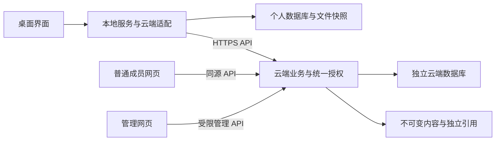
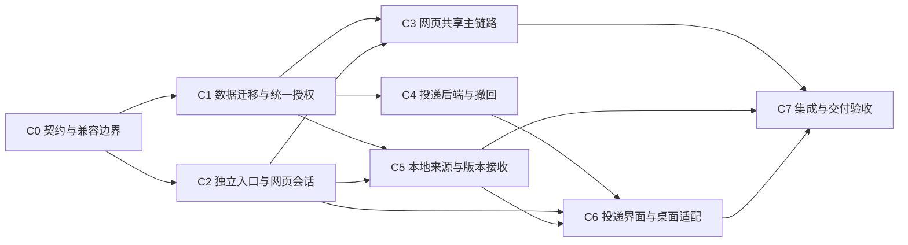

# TeamHub 云端与资料投递实施蓝图

> 让组织资料可以独立通过网页使用，让指定资料主动送到指定成员面前，同时保持个人库、组织共享和资料投递的边界清楚。

| 文档信息 | 内容 |
| --- | --- |
| 编号 / 版本 | TH-CLOUD-DELIVERY-PLAN / v0.2 |
| 建立 / 更新日期 | 2026-10-05 / 2026-10-05 |
| 上位依据 | [项目基石 v0.7](TeamHub项目基石.md)，特别是 §6—9、D-40—D-47 |
| 用途 | 下一轮代码开发的范围、数据关系、接口、阶段依赖、验收和回退依据 |
| 状态 | C0—C7 本机实现及隔离验收已完成；阶段交付及验证结果见 [验收记录](../reviews/云端与资料投递验收记录.md)，未迁移真实组织数据 |
| 观察基线 | 2026-10-05 本机工作区；分支 master、HEAD 9921c00，但大量既有成果尚未提交，不能以 HEAD 代替实际工作区 |
| 工程路线 | 沿用现有 Electron / Vue / FastAPI / SQLite 与受管快照；先隔离验证，再约 10 人内网试用 |

**阅读顺序：** 先读 §1—3 明确产品与现状，再按 §4—7 实现，最后以 §8—10 推进、验收和交接。旧 [MVP 蓝图](TeamHub-MVP实施蓝图.md)保留历史 M0—M7 安排；本蓝图用 C0—C7 编号，避免与既有阶段混淆。旧契约仍描述现有实现，本蓝图中的新增字段与接口均是目标设计。

**决定状态：** “已确认”来自用户明确意见；“工程方案”是为落实原则提出的实现选择；“待确认”属于仍有业务取舍的规则，不因写入本文而变成用户已确认。可以先建设通用结构、编写隔离用例；不得将待确认行为默默启用到真实资料上。普通技术细节由开发者依约处理，不额外设置审批。

## 1. 交付目标与已确认边界

| 编号 | 规则 | 基石依据 |
| --- | --- | --- |
| R01 | 本地不依赖云端登录、在线或启动成功；两端独立数据、进程、部署和生命周期，经 API 通信 | §1.2、§9.5 |
| R02 | 普通成员无需安装桌面端，可网页登录、查找、下载、上传和提交版本 | D-42、§9.7 |
| R03 | 支持指定一个或多个组织成员访问资料，不能仅凭同空间成员身份读取所有内容 | D-43、§6.4 |
| R04 | 组织管理员在应用内不默认读取定向共享和投递内容，必须明确授权 | D-44、§6.4 |
| R05 | 资料投递是独立功能：A 从本地发给 B，B 收到提醒，无需主动搜索 | D-45、§7.4 |
| R06 | 收到提醒不自动收录；收件箱是云端入口，B 主动收录后才进入本地待整理 | D-45、§7.4 |
| R07 | 发送者可撤回投递；撤回不能远程删除接收者已保存的副本，也不能取消其他独立共享权限 | D-46、§7.4 |
| R08 | 一次投递记录对应当时的确定内容；共享更新、本地恢复和更新本地遵循两端独立的版本规则 | §8.7—8.10 |
| R09 | 本地恢复选中已有版本，恢复本身不新增；接收不同的云端内容新增本地版本，必要时先保护工作修改 | D-38、D-40—41 |
| R10 | 默认私有，哈希只负责比较与校验；组织资料独立保留，个人删除不能支配其存续 | §6.1、§7.1、§8.2 |

### 1.1 三类入口

| 入口 | 内容与动作 |
| --- | --- |
| 个人管理（桌面） | 待整理、文档库、个人标签与版本；发布、投递、取回、更新本地是明确的跨端动作 |
| 组织共享（桌面与网页） | 只显示当前有权发现的资料；搜索、标签、上传新资料、提交版本、下载与访问范围管理 |
| 资料投递（桌面与网页） | 收到的资料、已发送的资料、未读提醒、说明、固定附件、撤回状态 |

查看资料的首版交付至少包括名称、说明、来源与版本详情及下载；不借“查看”承诺已支持所有办公/CAD 格式在线预览。既有可安全复用的预览另行列入验收，不影响下载主链路。

### 1.2 本轮不自动扩展

不实现聊天会话、多人实时编辑、自动合并、自动双向同步、收件自动落盘、跨组织外链、管理员冒用成员登录、任意格式转换、贡献排名或复杂审批。应用关闭后的操作系统推送不属于首版承诺；离线收件持久保存，重新连接后可见。云端单版本删除沿用基石 Q-14 未决状态。

## 2. 待确认事项与可继续开发的边界

以下推荐用于形成可执行候选，不作为已确认权限或留存政策。确认结果写回本表、基石及对应验收用例，不要求重新推翻整个蓝图。

| 编号 | 尚未定案 | 推荐首版方案 | 影响与处理 |
| --- | --- | --- | --- |
| P01 | 指定成员能否共同维护、谁能再次分发 | 可查看 / 可协作；默认可查看。协作允许标签贡献与版本提交，但不自动获得授权管理或转投权；资料管理者单独授权 | C1 可先完成读取隔离；相关写权限和分发策略启用前确认；基石 Q-15 |
| P02 | 整次撤回还是逐收件人撤回 | 先整次撤回，确认框列出全部受影响接收者 | C4 撤回状态模型及 C6 界面验收前确认；不能将上一轮助手建议记作用户已同意；Q-16 |
| P03 | 仅投递资料的组织资产属性、保留期限、撤回后发送者取用与清理 | 不自动发布为组织共享资料；开发及隔离验收保留附件和记录，暂不自动过期或物理删除；撤回后的收件端禁取，发件端是否继续取用另定 | 不妨碍建模和隔离收发验证；真实资料试用前确定责任、配额、期限和清理规则。开发期保留不是永久留存承诺；Q-17 |
| P04 | 指定资料的授权管理者、离职移交及例外治理 | 创建者为初始资料管理者；可以明确移交；组织管理员不能自行授予自己读取权。无人可授权时保留内容及其他成员既有有效授权，暂停新增授权管理，不自动公开或删除 | C1 实施主动移交与最后管理者保护；离职例外流程与定向资料删除条件在真实试用前确定；Q-18 |

这里的“可协作”“资料管理者”是资源权限，区别于账号的组织管理员身份。现有全空间资料的协作规则继续保留；新增指定共享不能未经决定就继承“所有成员均可写”。

## 3. 现有代码与复用边界

本节为静态核查结果，不是新增功能测试报告。

| 实际位置 | 现状 / 下一步 |
| --- | --- |
| `cloud_backend/app/models.py` | 已有 User、Team、Workspace、CloudDocument、CloudVersion、PublicationRequest；新增资料访问关系和投递模型，不重建现有历史 |
| `cloud_backend/app/core/deps.py` | 当前主要检查团队角色、空间及资料归属；增加统一资料/附件能力判定，并提供查询可见范围过滤 |
| `cloud_backend/app/api/documents.py` | 搜索、列表、详情、版本、标签等有空间级查询；必须统一限制字段、计数、历史和可见集合 |
| `cloud_backend/app/api/publications.py` | 可复用流式上传、服务端校验、请求幂等、基准版本与下载；内部查重、幂等重放也须按即时权限检查 |
| `cloud_backend/app/api/collaboration.py` | 标签、回收/恢复/永久删除、联想、协作上下文需接入资料级权限；不能以 workspace 的 can_manage 直接决定每份资料按钮 |
| `cloud_backend/app/api/workspaces.py`、`admin.py` | 活动流可能暴露 entity_id/payload；回收站、管理统计、容器删除要纳入范围控制 |
| `backend/app/api/sharing.py`、`core/cloud_client.py` | 桌面共享主要经本地适配层；当前取回偏向新本地对象，新增“更新既有本地资料”不能直接借取回替代 |
| `backend/app/services/versions.py`、`snapshots.py` | 复用不可变快照、修改检测与恢复补偿；新增远端更新事务，不改变本地恢复语义 |
| `frontend/src/stores/auth.js`、`api/collaboration.js`、`pages/SharedInboxPage.vue` | 普通共享页面依赖本地服务，SharedInbox 名称不代表已有资料投递；需拆分共享组件与桌面/网页适配层 |
| `frontend/src/admin/`、`frontend/vite.config.js` | 有管理入口与多入口构建基础；新增普通成员云端入口，独立 API 与会话，不能整页照搬依赖本机端口的页面 |
| `scripts/mvp-dev.sh`、`electron/backend-manager.js` | 桌面应用自启个人后端，但联调脚本先启共享服务；提供独立桌面、独立云端、联调三种明确启动入口 |
| `cloud_backend/alembic/versions/004_mvp_contract.py`、`alembic/env.py` | 当前迁移基线；启动 create_all 不会替代旧表升级，后续须显式迁移并检查 schema 版本 |

复用测试：云端 `test_permissions.py`、`test_m4_publications.py`、`test_m5_collaboration.py`、`test_model_constraints.py`、`test_migration.py`、`test_decommissioned.py`；本地 `test_m4_session.py`、`test_m4_sharing_e2e.py`、`test_m5_collaboration_e2e.py`、`test_m6_abc_collaboration.py`；桌面隔离脚本 `scripts/test_m4_ui.cjs`、`test_m5_ui.cjs`、`test_library_navigation_ui.cjs`。

## 4. 总体结构与通信

### 4.1 运行与接口契约

- 云端网页只连接云端服务；没有 Electron、本机 Python 或个人库时仍能登录、查找、上传下载。桌面继续通过个人后端处理本地快照、会话和收录。
- 正式内网以 HTTPS 部署，同源托管成员页、管理页和 `/api`。本机回环 HTTP 只作开发用途。现有依赖锁与单体服务先沿用，不引入消息中间件或另一套存储服务。
- 增加 `GET /api/server-info`，返回持久 `server_id`、协议主版本、schema/能力标识；无敏感成员或资料信息。地址可以变，服务身份不以 URL 代替。
- 客户端按当前配置的受信地址连接，先核对服务身份与协议。不能从任意资料来源 URL 自动携带令牌访问；同 ID 不替代 TLS/地址信任验证。换址需显式重新绑定并核对，备份恢复同一服务保留身份，独立克隆服务重新生成身份。
- 保留兼容的既有 API；新增字段和能力明确声明。旧客户端缺少新操作所需的显式范围时返回清楚的 `SCOPE_REQUIRED` / `PROTOCOL_INCOMPATIBLE`，不静默扩大共享；该失败只影响相关云操作，不影响本地管理。旧路由也必须执行新的权限检查。

### 4.2 账号与网页会话（工程方案）

桌面沿用本地服务持有云端凭据的方式。网页新增独立会话适配，复用服务端账号、密码校验、刷新轮换与停用逻辑，不调用本地 `/api/sync/*`。

推荐网页访问令牌只放内存，刷新凭据用同源 HttpOnly Cookie；正式部署设置 Secure、限定 Path 与 SameSite，退出与停用撤销会话。Cookie 参与的登录、续期和退出请求验证来源并落实 CSRF 防护，不以 SameSite 单项代替完整验证。前端不把刷新凭据写入 localStorage。成员页与管理页统一适配，避免保留旧页面的权限/会话旁路。会话属性的技术依据见 [OWASP Session Management](https://cheatsheetseries.owasp.org/cheatsheets/Session_Management_Cheat_Sheet.html)。

### 4.3 提醒不承担资料存续

首版工程默认使用登录期间的轻量轮询：前台约 10 秒、网络错误退避、隐藏页面降低频率、退出时停止；间隔可配置。数据库内收件记录才是事实来源，弹窗失败或页面关闭不丢件。不实现浏览器关闭后的 Web Push，也不把提醒已展示等同于文件已保存到接收者电脑。

## 5. 资料权限与投递授权

### 5.1 两条独立的访问依据

1. **资料共享授权**：针对资料对象，允许查找该资料、读取其允许范围内的元数据和版本；指定共享使用明确成员关系。
2. **投递授权**：针对某次投递中固定的附件，只能从投递入口取得已发送内容，不授予源资料的其他历史、新版本、标签或管理权限。

统一判断流程为：账号有效 → 当前组织成员资格 → 资源归属 → 本次操作对应授权 → 内容/状态校验。组织角色不能绕过指定授权。服务端每次访问验证授权，列表和聚合在数据库过滤后再分页、计数；默认拒绝与逐请求授权的依据见 [OWASP Authorization](https://cheatsheetseries.owasp.org/cheatsheets/Authorization_Cheat_Sheet.html)。

普通资料下载要求资料授权；投递附件下载要求该投递有效。撤回后附件接口拒绝，B 若还有独立共享权，须通过共享入口访问，不能把已撤回的投递显示成仍然有效。反向同理：只取消资料共享权不自动撤销已发出的独立投递。

**收件端附件读取的必要条件：** 当前用户是该投递明确登记的有效收件人，账号与组织资格有效，附件属于该投递，且该收件资格未因相应撤回失效。仅属于同组织、管理源资料、拥有其他共享权或知道附件 ID 都不能替代收件资格。发送者可查看自己的发件记录，但发件端附件取用另按 P03 决定，不以发件记录权限直接放行正文。未获授权的管理员同样不能例外。

### 5.2 权限候选矩阵

本表是 P01/P04 的推荐实施方案，组织管理员“不默认读取指定内容”是已确认约束。

| 能力 | 全空间共享 | 指定资料 reader | 指定资料 contributor | 指定资料 manager | 仅投递收件人 |
| --- | --- | --- | --- | --- | --- |
| 搜索、查看资料及版本、下载 | 有效空间成员 | 允许 | 允许 | 允许 | 只查看本次投递及固定附件 |
| 添加标签、撤销本人标签关联、提交新版 | member 及以上 | 不允许 | 允许 | 允许 | 不允许操作源资料 |
| 修改可见范围、授权或收窄权限 | 资料管理者；公共资料可由组织治理规则处理 | 不允许 | 不允许 | 允许并留痕 | 不允许 |
| 从已有云资料直接发起投递 | 首版建议限资料管理者 | 不允许 | 不自动允许 | 允许，发送时再次校验 | 不自动获得转投权 |
| 删除组织资料 | 原组织管理员规则 | 不允许 | 不允许 | 单有 manager 不等于组织删除权 | 不允许 |

账号的团队 viewer 角色仍是写操作上限，不能凭指定 contributor 绕过；指定资料永久删除建议同时要求组织治理角色及该资料明确的管理授权，P04 定案前不开放该敏感动作。组织管理员可管理账号等组织配置，但不能自授内容读取权、借活动流或文件列表读取未获授权的指定资料。

创建指定资料时为创建者建立初始 manager；主动撤销或移交不得留下没有有效管理者的资料。成员被停用或退出时，其访问立即失效，资料保留；如果因此失去最后管理者，暂停新的授权管理并等待明确移交流程，不自动公开，也不因此清除其他成员已有的有效访问权。不要通过阻止必要的账号停用来掩盖这一状态。

给管理员明确内容授权的入口：资料由有权管理者添加其访问关系；投递由发送者把该管理员作为接收者，或另行发起一次明确投递。管理员不能凭组织角色修改这些关系。这里约束的是应用内权限，不把它扩大为服务器运维人员无法访问磁盘的加密承诺。

### 5.3 必须覆盖的读取面与泄漏面

搜索、列表、详情、版本数、当前版本、历史、下载、标签列表、名称/标签/共现联想及频次、哈希查重、收藏解析、回收站及计数、空间活动流、发布请求结果与幂等重放全部使用同一权限规则。隐蔽资料对无权成员的响应与不存在一致，不返回其名称、标签、哈希、数量或存在性。

普通资料详情不得因拥有一个投递附件而返回整个 versions 集合。投递响应使用明确 DTO，只含发送者主动发送的文件名、说明、版本标识和附件信息；不暴露源文档标签集合或其他接收者名单。内部查重的 `_find_duplicate`、`_doc_brief` 也须改造，不只修改单独的 `/duplicates` 路由。

后台允许的系统容量汇总与受限内容明细分开；活动日志面向操作者/获授权者过滤。容器级删除（团队、空间）在存在组织资料或投递引用时不得直接级联销毁，需停用/归档或走后续明确治理流程。对象存储不提供绕过授权的静态目录、公开对象 URL 或长期有效直链。

## 6. 对象关系、投递状态与版本行为

### 6.1 建议新增或调整的数据

字段名为工程方案，C0 固定 DTO/约束后实施，不表示现有数据库已经包含这些结构。

| 对象 | 最小字段与约束 |
| --- | --- |
| server_metadata | 持久 server_id、schema/protocol 标识；单例，备份与克隆规则明确 |
| cloud_documents 扩展 | `visibility=workspace/restricted`、`access_revision`；与内容版本独立，范围变化不生成内容版本 |
| document_access | document_id、user_id、role、granted_by、created_at；资料/成员唯一，授权对象须属于当前组织；包含初始 manager |
| deliveries | id、team_id、workspace_id、sender_id、request_id、request_hash、说明、状态、sent_at、recalled_at；`(sender_id, workspace_id, request_id)` 唯一，重试不能复活撤回记录 |
| delivery_recipients | delivery_id、recipient_id、read_at；联合唯一。若 P02 选逐人撤回，再增加每人撤回状态，不能仅靠顶层状态实现 |
| delivery_items | id、delivery_id、文件名、类型、storage_key、内容摘要、归档摘要、大小；固定不可变。可选 source_document_id/source_version_id 仅作逻辑来源，不级联依赖源资料 |
| cloud_operation_logs | 操作者、动作、对象 ID、时间、授权或撤回结果；复用/扩展现有审计结构，读取需授权，不把正文、令牌写入日志 |
| 本地 VersionSource | local_document_id、local_version_id、server_id、workspace_id、source_type、源资料/版本或投递/附件 ID；可记录多次对应，不改写本地版本原作者和创建原因 |
| 本地 ShareLink 扩展 | server_id、已确认的基准、最近观察版本分开；文档关联保留，历史版本删除不级联抹除提交基准 |
| 本地 RemoteOperation | 请求 ID、账号/服务身份、固定目标及输入、进度/日志位置、结果；用于发送重试、接收及文件/DB 一致恢复 |

`delivery_items` 独立持有受管内容引用。来源于本地文件的投递不必先创建一份 CloudDocument；来源于已有云版本的投递可以复用其不可变对象，但需保留独立引用。投递既不依赖发送者本机路径，也不因源资料当前版改变而改变附件。

所有物理对象清理同时核对 CloudVersion、DeliveryItem 和尚在完成中的受管操作引用。只按 CloudVersion 查询再删除文件会破坏投递。源资料删除不级联删除已经有效发送的快照；彻底清除所有引用属于另行定义的治理动作。初版未确定留存政策前不自动物理清理已发送附件，但上传失败且从未发布/投递的暂存对象可按受控任务清理。

### 6.2 投递的最小状态机

| 阶段 / 状态 | 行为 |
| --- | --- |
| 准备发送（客户端） | 选择一份资料、一个确定版本和一个或多个有效成员，可写说明；整套文件夹作为一份附件。首版建议一次投递一份资料，多附件批量另议 |
| 上传中 / 暂存 | 服务端验证身份、配额、大小与内容完整性；接收者尚看不到半成品 |
| 已发送（服务端提交成功） | 附件引用与全部收件记录在同一事务成立，显示“已存入对方收件箱”；不声称对方在线、已读或已落盘 |
| 未读 / 已读（各收件人） | 收件人打开该投递详情后更新自己的 read_at；仅列表刷新或弹通知不自动标记已读；发件人阅读回执未确认，首版不据此增加追踪界面 |
| 已撤回 | 发送者请求通过且事务提交后，该撤回范围内的新附件获取请求被拒绝；收件箱显示已撤回记录，不自动变为另一份公开资料 |
| 发送失败 / 结果待核对 | 保留固定请求 ID，可查询结果再重试；不重复发送、不提前报告成功 |

发送时再次验证所有目标成员及发送者分发资格；任一无效则整次不提交，明确提示修改名单。成员搜索只限所属组织，不能列出别的组织或敏感权限关系。

投递成功冻结附件与目标集合。需要发新版本或加接收者时，首版建议新建投递，保留发送记录。撤回不能撤销另一次投递；同一附件发两次时分别计算资格。P02 若改为逐人撤回，只修改相应收件资格，不修改不可变内容。

撤回与下载采用清楚的生效点：授权检查在撤回事务提交后的新请求必须失败；检查已完成、正在进行的传输不能承诺收回已发送字节。初版方案允许已授权开始的下载完成，界面不暗示可收回已取走内容；如需要中途终止，应另增明确验收。再次打开、断点续传或重试均重新授权。浏览器缓存使用适当的私有/不存储策略，但不承诺擦除已经展示或保存的内容。

### 6.3 收录与更新不可混淆

- 共享资料首次取回按现有本地规则建立独立资料与来源；已有关联时，明确选择更新已有资料或另存一份，不能按名称/哈希自行合并身份。
- B 从投递点击“收录到待整理”，创建本地对象、初始版本和投递来源。此操作不自动创建有提交能力的 ShareLink，不授予源文档历史或新版权限。需要参与源资料协作时另取明确授权。
- 普通网页下载只保存文件；网页没有本地服务时不显示“已收录到 TeamHub”。桌面收录需返回真实本地对象结果。
- 更新已有本地资料严格执行基石 §8.8 的三方内容比较：当前快照、工作文件、固定云端目标。两端版本独立编号，重复结果不造版，必要时先保存修改，再接收新内容；标签、分类、收藏、状态和资料身份保持。
- 已确认提交基准、版本来源和观察到的云端当前版分别记录。浏览或下载失败不能推进基准；恢复旧本地版后再提交须明确旧内容重新发布，服务端仍验证基准。
- 本地更新使用暂存、校验、持久操作日志和补偿；进程中断后必须能识别并恢复未完成状态。启动恢复不得覆盖期间出现的外部编辑，无法判明时保留双方内容并提示处理。

## 7. 目标 API 与行为契约

路由命名可在 C0 做一致化调整；授权范围、幂等输入和返回语义不得省略。JSON 表达元数据，内容通过鉴权的流式通道传输，不接受客户端自报摘要替代服务端校验。

| 路由 / 改造位置 | 输入或结果 | 关键约束 |
| --- | --- | --- |
| GET `/api/server-info`（新增） | server_id、协议与能力 | 不含资料/成员信息；客户端不兼容时只禁用相关云操作 |
| POST `/api/web-auth/login`、`refresh`、`logout`（新增） | 网页会话和用户摘要 | 服务端复用既有账号逻辑；Cookie 安全和 CSRF；不依赖本机服务 |
| 既有 `/api/workspaces/{ws}/documents*`、`suggestions`、`duplicates`、`activity` | 可见资料、聚合和活动 | 全链路按当前用户授权，先过滤再计数；不存在与不可见一致 |
| 既有 POST `…/publications` 扩展 | 明确 visibility、指定成员与所选权限、固定内容、request_id | 初始 manager 与发布一起提交；缺范围不默默全员公开 |
| GET/PUT `…/documents/{doc}/access`（新增） | 指定成员、权限、base_access_revision | 只有授权管理者可读写完整授权关系；写时校验并发、有效成员、管理者存续，留痕 |
| 既有版本提交/下载/标签/回收接口 | 维持版本与标签语义 | 每份资料重新核查操作能力；提交仍携带 base_version_id |
| POST `…/uploads` 扩展 | purpose、文件元数据、流式内容；返回 upload_id | 票据绑定操作者、空间和用途；消费时再校验，禁止用裸 storage_key/hash 取得内容 |
| GET `…/delivery-members`（新增） | 当前可选的有效组织成员 | 不读取成员的私人资料，不绕过组织成员资格 |
| POST `…/deliveries`（新增） | request_id、recipient_ids、说明；upload_id 或源资料/固定版本二选一 | 输入摘要绑定目标、附件、说明；服务器重验分发权，附件与收件记录完整提交 |
| GET `…/delivery-requests/{request_id}`（新增） | 本人发送结果 | 只限操作者，返回当前状态；撤回后重试不复活，不向失权者重放正文 |
| GET `…/deliveries?box=inbox/outbox`、GET `…/deliveries/{id}` | 分页记录与本人可见详情 | 不接收任意 user_id 来查询别人的收发件箱；管理员无默认旁路 |
| GET `…/deliveries/unread-count`、POST `…/{id}/read` | 本人未读数、已读状态 | 固定路由在动态 `{id}` 前；幂等标记，只影响当前接收者 |
| GET `…/{id}/items/{item}/download` | 固定附件字节 | 当前用户必须是有效收件人，item 属于 delivery，账号/组织资格有效且该接收资格未撤回；发送者取用另按 P03；不解析成源文档当前版本 |
| POST `…/{id}/recall`（新增） | 本次撤回状态 | 限发送者；幂等；P02 决定整次或逐人请求形态 |
| 本地 POST `/api/deliveries/send`（新增） | 本地 doc_id、version_id、接收人、说明、request_id | 必要时保存所选工作内容为版本，固定发送负载；不重做原文件收录/移动 |
| 本地 `/api/deliveries/*` 列表/详情/撤回/收录适配 | 当前云端账号与服务身份 | 不把云端网页请求转回这些本机接口；收录只在明确操作后执行 |
| 本地 POST `/api/sharing/update-local`（新增） | local_document_id、固定目标 version_id、request_id | 验证已有来源/资料关系；日志、校验、补偿和本地历史保护一致完成才报告成功 |

投递类云端路由均以 `/api/workspaces/{ws}` 为前缀；身份和组织归属始终验证。投递不是普通资料授权的替代接口。

新错误码建议：`SCOPE_REQUIRED`（422）、`PROTOCOL_INCOMPATIBLE`（409）、`ACCESS_REVISION_CONFLICT`（409）、`DELIVERY_RECALLED`（410，仅已知收件人/发送者可得到）、`INVALID_RECIPIENTS`（422）、`TRANSFER_PENDING`（409）、`QUOTA_EXCEEDED`（413）。延用 `NOT_FOUND`、`FORBIDDEN`、`REQUEST_MISMATCH`、`STALE_BASE_VERSION`、`CONTENT_UNCHANGED`。无授权旁观者不能通过这些状态码探测投递存在。

幂等请求的重放仍检查当前身份与访问条件：同键不同负载拒绝；同键已成功返回同一对象及其当前撤回状态；不能在网络重试时重新读取工作文件或换成云端最新版本。发送者本地更新日志也绑定 server_id、账号和固定内容，换账号不能拿旧请求继续操作。

## 8. 开发阶段与依赖

各阶段以可独立审查的变更为单位，必要时拆成小提交。下面“新增测试”路径为计划产物，完成对应阶段后才应存在；不把文件尚未创建当成既有测试失败。

### C0：冻结契约与建立执行基线

- **前提 / 背景：** 现有工作区有大量未提交成果；新增规则不能被旧蓝图“管理员可管理一切”或自动同步字段覆盖。
- **任务 / 文件：** 逐项登记 P01—P04 状态；将 §5—7 固定为 DTO、能力矩阵和 schema 迁移清单，补充 `docs/architecture/MVP数据与接口契约.md` 的新章节。列出兼容客户端的读写规则和能力标识；保存本轮实施前文件清单与隔离基线。不得 reset/clean 或把既有改动混入本轮提交。
- **退出标准：** 资料授权和固定附件授权有可验证输入/输出；每个待决项有明确影响的功能，不阻塞无关基础工作；旧路由清单无遗漏。
- **验证：** 检查现有基线并记录结果：根目录运行 `venv/bin/python -m pytest backend/tests -q`；云端目录运行 `venv/bin/python -m pytest tests -q`。只在开始实施时跑一次，不因文档本身重复运行。
- **回退：** 本阶段只形成契约和基线，无数据库变化。负责人应能独立阅读本文并说明权限、投递和本地版本关系。
- **执行能力：** 由能够处理跨端模型与授权的高能力模型/开发者负责，独立复核边界；后续执行不绑定具体模型品牌或版本。

### C1：资料级权限、投递数据基础与迁移

- **依赖：** C0；P01/P04 未定时可完成读取隔离和结构，不启用未确认的写权或受限资料删除。
- **背景 / 目标：** 现有检查以空间为主，新增资源权限必须覆盖读取聚合和所有写入口。
- **任务 / 文件：** 修改 `cloud_backend/app/models.py`；新增 `app/services/access.py` 与统一查询过滤；改 `core/deps.py`、`api/documents.py`、`publications.py`、`collaboration.py`、`workspaces.py`、`admin.py`；规划下一 Alembic revision（当前 head 004，实施时先核查）。创建 server_id、资料可见性/授权及投递关系基础，避免后续多阶段同时修改同一模型。
- **迁移：** 旧公共资料显式回填为 workspace 可见，不凭历史作者推断成指定分享；只有新创建且明确指定的对象使用 restricted。给可识别创建者回填管理关系，缺失/停用创建者按受控报告处理。旧 ShareLink 的 URL→server_id 须连到正确服务核对，离线记录待绑定，不能跨服务猜测合并。
- **退出标准：** A→B 指定资料对同空间 C 和未获授权管理员不可发现；授权后仅获得所授能力；撤权即时影响新请求；活动、查重、标签与幂等重放无旁路；迁移可重跑且不改文件内容。
- **验证：** 新增云端 `tests/test_document_access.py`、`test_cloud_delivery_migrations.py`，扩充 §3 既有权限/发布/协作/迁移测试。云端目录：`venv/bin/python -m pytest tests/test_document_access.py tests/test_cloud_delivery_migrations.py tests/test_permissions.py tests/test_m4_publications.py tests/test_m5_collaboration.py tests/test_migration.py tests/test_decommissioned.py -q`。
- **回退：** 新功能未写真实数据前可弃用空新增结构；出现 restricted 或投递数据后禁止回退到无新授权的旧服务，必须维护停机并恢复经核对备份或前向修复。不能仅关前端按钮后运行旧后端。
- **执行能力：** 高能力实现与安全/数据库独立复核；需关注真实并发而非仅顺序请求。

### C2：两端独立启动、云端网页入口与会话

- **依赖：** C0；与 C1 可并行，server-info/模型变更由 C1 统一负责，C2 按契约接入。
- **背景 / 目标：** 普通共享页当前依赖本地后端，新网页必须在没有桌面进程时成立。
- **任务 / 文件：** 新增 `frontend/cloud.html`、`frontend/src/cloud/` 的 main/router/App/auth/API 适配；新增云端 `api/web_auth.py` 并复用认证服务；调整 Vite 多入口与同源托管、CSP，保留桌面回环限制。共享展示组件与传输层分离，禁止云网页导入本地 token store/loopback request；检查并替换旧 `api/cloud.js` 等被实际使用的旧会话入口。
- **启动：** 更新 `scripts/mvp-dev.sh` 提供明确的 local/cloud/all 路径（实际命名在 C0 固定），桌面独立入口不检查云端虚拟环境或端口。云端部署包不携带个人库，也不需要安装 Electron。
- **退出标准：** 云端停机本地仍可整理；停止本地服务后网页可登录、续期、退出；浏览器网络请求不依赖 8001 等个人端口；停用账号即时失效，旧管理页面无鉴权旁路。
- **验证：** 新增云端 `tests/test_web_auth.py` 与 `scripts/test_cloud_web_ui.cjs`（采用浏览器测试运行器，不能借 Electron 私有桥冒充独立网页）；根目录 `npm run frontend:build`，云端目录 `venv/bin/python -m pytest tests/test_web_auth.py -q`，根目录 `node scripts/test_cloud_web_ui.cjs --auth-only`。
- **回退：** 下线新网页入口可保留兼容的桌面服务；Cookie/路由调整需清除相应会话并重新登录，不回退 C1 的授权保护。
- **执行能力：** 常规实现配合会话与独立运行审查。

### C3：网页组织共享主链路

- **依赖：** C1、C2；指定成员协作与范围管理按 P01/P04 决定开放。
- **任务 / 文件：** 在 `frontend/src/cloud/` 实现共享检索、资料详情、版本、上传新资料、提交新版本、下载与范围选择；提取可复用展示组件，桌面保留本地适配。服务端返回按资源计算的 capabilities，界面显示适当动作；服务端仍独立验证，不信任前端按钮。
- **要求：** 上传显示目标范围、进度和可重试状态；普通成员可选组织成员，但不能查看无权资料；浏览器上传保留本机文件；用户明确选择“新资料”或“已有资料新版本”，不能按同名猜测。首期普通文件/压缩包网页上传成立；整体文件夹的浏览器收集封装应单独验证后启用，不能与桌面整体快照混淆。
- **退出标准：** A 发布给 B，B 能检索下载，C 与未授权管理员不可见；授权 contributor 后才有协作动作；并发基准冲突可理解且没有覆盖历史。
- **验证：** 扩充 `scripts/test_cloud_web_ui.cjs` 场景；根目录 `node scripts/test_cloud_web_ui.cjs --sharing`、`npm run frontend:build`，云端受影响 API 测试通过。
- **回退：** 关闭新增发布入口保留已发布资料可按权限读取，不能把 restricted 批量改成公共以兼容旧 UI。
- **执行能力：** 常规实现，权限矩阵和用户流程独立复核。

### C4：投递、固定附件与撤回后端

- **依赖：** C1；P02 决定撤回操作粒度，P03 决定真实留存行为；可先以候选规则在隔离库开发。
- **任务 / 文件：** 新增云端 `api/deliveries.py`、`schemas/delivery.py`、`services/deliveries.py`，注册路由；复用 `core/object_store.py`，补充引用检查、配额与 upload 用途；`api/publications.py`/协作清理调用统一对象引用服务，模型由 C1 基线扩展而非重复定义。
- **要求：** 上传完成再建立送达，固定附件；有效成员与源分发权在事务中复查。写入采用现有短事务/条件更新习惯；不在 SQLite 写锁内执行完整大文件上传。撤回、成员失权、重试与新下载有明确生效顺序。
- **退出标准：** 多接收者离线也有各自记录；上传/事务失败没有半件；重试不重复；撤回后新下载失败且原有独立共享仍可用；删源资料不破坏有效附件；单投递读取不泄露源历史。
- **验证：** 新增云端 `tests/test_deliveries.py`、`test_delivery_access.py`、`test_delivery_concurrency.py`；云端目录 `venv/bin/python -m pytest tests/test_deliveries.py tests/test_delivery_access.py tests/test_delivery_concurrency.py tests/test_m5_collaboration.py -q`。必须包含真实并发撤回/下载授权检查和失败补偿，不仅模拟成功返回。
- **回退：** 暂停新投递；保留已发记录和受管内容，以兼容授权服务供存量访问或进入维护状态。未定保留期限前不能将停用功能解释为清空附件。
- **执行能力：** 高能力实现与授权/事务/存储引用独立复核。

### C5：本地版本来源与云端更新

- **依赖：** C1、C2 的服务身份和稳定 API；可与 C3/C4 独立推进，新增本地服务文件分工明确。
- **任务 / 文件：** 本阶段负责 `backend/app/models.py`、`core/migrations.py` 中 VersionSource、RemoteOperation 的建表/升级与恢复基础，同时覆盖 shared/delivery 两种来源及发送冻结负载；新增 `services/remote_update.py`，改 `api/sharing.py`、`services/versions.py` 的复用边界，前端详情抽屉提供“更新本地”及状态。ShareLink、共享收藏和本地发布日志从地址身份迁到已验证 server_id，兼容未联网的旧记录。C6 使用本阶段的持久化接口，不另建一套只在内存保存的请求/来源记录。
- **要求：** 实现基石 §8.8 全部内容关系；共享目标固定版本 ID；操作日志持久化、校验/修改保护/文件切换/元数据提交可恢复。投递收录只记投递来源，不混成可向源资料提交的关联。
- **退出标准：** 恢复历史不新增的已有行为保持；云端新内容成为新本地版本；按基石 §8.8 处理重复内容与重试，仅匹配更早历史而不同于本地当前快照的云端目标仍新增接收记录；失败/重启后可识别结果，源服务/账号不匹配阻止跨服务误提交；本地历史删除不抹除必要基准。
- **验证：** 新增 `backend/tests/test_remote_update.py`、`test_version_sources.py`；根目录 `venv/bin/python -m pytest backend/tests/test_remote_update.py backend/tests/test_version_sources.py backend/tests/test_m2_lifecycle.py backend/tests/test_m4_sharing_e2e.py -q`；扩充 `scripts/test_library_navigation_ui.cjs` 的更新与恢复对照。覆盖文件与整体文件夹、断点故障、外部编辑及旧版再提交。
- **回退：** 关闭远端更新入口后本地仍可工作；新来源表保留。版本序号不倒退、已生成快照不删除；恢复前向兼容或使用停写备份，不将新库直接交给不理解新操作日志的旧程序。
- **执行能力：** 高能力实现与文件/数据库一致性独立复核。

### C6：收发件箱、提醒与桌面发送/收录

- **依赖：** C2、C4、C5（特别是 VersionSource / RemoteOperation 迁移与持久恢复接口）；网页界面可在 C2/C4 后先行制作，完整桌面发送/收录验收须等待 C5。共用导航/API 组件由同一负责人集成。
- **任务 / 文件：** 新增 `frontend/src/components/delivery/` 及桌面/网页投递页面；新增本地 `backend/app/api/deliveries.py` 与转发服务，复用 `cloud_client.py` 和 C5 的冻结请求/来源持久层；接入导航、未读轮询和本地资料操作入口。普通 SharedInboxPage 保持组织资料职责，不把两个功能揉成同一列表。
- **要求：** 收件显示发送人、说明、时间、固定附件；撤回状态保留。发送表单明确对象与接收者，失败可查原请求。桌面收录显式落入待整理、保留来源；网页只提供下载，不伪造本地收录。提醒不包含无权预览内容，退出/撤权后刷新可见状态。
- **退出标准：** A 本地一键完成投递（必要的选择集中在一个表单）；B 无需搜索能看到未读；未点击收录时本地库不变化；收录后撤回不删个人副本；网页无本地依赖。发送后重启仍能核对原请求，收录后重启仍可追溯来源。
- **验证：** 新增 `backend/tests/test_delivery_adapter.py`、`scripts/test_delivery_ui.cjs`；根目录 `venv/bin/python -m pytest backend/tests/test_delivery_adapter.py backend/tests/test_version_sources.py -q`、`node scripts/test_cloud_web_ui.cjs --delivery`、`env -u ELECTRON_RUN_AS_NODE node_modules/.bin/electron scripts/test_delivery_ui.cjs`。界面脚本使用临时服务、合成资料和临时桌面 profile。
- **回退：** 下线发送按钮不抹除已发资料；停止轮询不丢数据库收件记录；本地收录的资料继续按个人库使用，C5 形成的来源与操作日志保留。
- **执行能力：** 常规实现加跨端联调复核。

### C7：跨端验收、备份迁移与交付

- **依赖：** C3、C5、C6；P01—P04 中影响实际启用的政策已记录决定，真实部署环境另确认。
- **任务 / 文件：** 更新 `scripts/mvp-backup.py` 使用的 `backend/app/core/backup.py` 对新对象引用和 server_id 的处理；迁移检查接入云端启动/运维指引；形成 `docs/reviews/云端与资料投递验收记录.md`，更新启动与交接文档。构建独立网页部署产物和桌面包，分别验证。
- **退出标准：** §9 必需场景通过，兼容旧数据；在没有桌面环境的浏览器完成主链路，关闭云端仍完成本地任务；有新库备份恢复演练及旧程序拒绝不兼容库的证据。未部署真实内网时结论只到本机隔离验收，不宣称组织试用完成。
- **验证：** 根目录 `venv/bin/python -m pytest backend/tests -q`、`npm run frontend:build`；云端目录 `venv/bin/python -m pytest tests -q`；根目录 `node scripts/test_cloud_web_ui.cjs`、桌面投递/导航隔离脚本。最后需要实际打包时才执行 `npm run backend:build` 和本机已有的 Electron 构建命令。相同构建通过后不无故重复全量测试。
- **回退：** 停止写入，核对日志及操作状态，恢复到全新隔离目标验证后切换。不要仅降级二进制而让旧鉴权读取包含指定资料的新库；明确备份时点之后的数据差异，不能静默丢弃。
- **执行能力：** 独立验证者复核权限、版本及迁移；实施者提供可重现命令和证据，不用自评分代替结果。

## 9. 必需验收场景

准备 A、B、C 和管理员 M，同一测试组织；另建无关组织成员 N。使用临时数据库、合成文件与隔离 profile，不把真实个人库或真实组织资料当作测试数据。

| 编号 | 场景与必须成立的结果 |
| --- | --- |
| V01 | 云端停机、注销或协议不兼容，本地整理/搜索/版本仍可用；本地服务不存在时网页共享与投递仍可用 |
| V02 | A 指定给 B；C、N、未获授权 M 的列表、详情、历史、下载、标签、活动、查重、计数均不能发现该资料；猜 ID 无效 |
| V03 | M 经明确授权后只得到所授能力；不能自授、用管理页面、回收站、旧路由或请求结果旁路读取 |
| V04 | 依据 P01 最终矩阵验证查看、协作、分发、管理分别生效；取消权限后新的读取/写入/幂等重放不能越权 |
| V05 | A 投递固定 X/V1 给离线 B，B 重连可见；同组织无关 C、未授权 M 和跨组织 N 即使猜到投递/附件 ID 也不能获取。A 本地改名/删除或云 X 更新 V2，不改变本次附件；仅有投递权的 B 看不到 V2 或其他历史 |
| V06 | A 同次发送给 B、C，内容完整才出现收件记录；非法接收者、上传中断、提交失败不产生半成品；同请求重试不重复 |
| V07 | B 不操作时本地库不变；主动收录后形成待整理、初版及投递来源；撤回不删除此个人对象 |
| V08 | 撤回后新附件请求失败，撤回记录仍在；独立共享或另次投递仍可用。P02 未定时只验证不变量，不以整次/逐人某一候选宣布产品验收完成 |
| V09 | 下载与撤回并发，授权生效顺序明确；断点/重试重新鉴权；已开始传输遵循 §6.2 的明示边界，不承诺远程擦除 |
| V10 | 删除源资料时有效投递仍能取回固定快照；共用物理内容不导致越权或误删；容器删除不级联毁掉受限资料/投递 |
| V11 | 当前快照/工作内容/云目标的相同与不同组合、目标匹配旧历史、重复更新都符合基石 §8.8；版本号单调、不复用 |
| V12 | 恢复本地旧版不动云端；再次提交明确旧内容成为新共享版本；别人先提交导致基准过期时不静默覆盖 |
| V13 | 下载中外部编辑、磁盘满、校验错、DB 提交失败、进程中断后重启均保留可恢复资料；不报告虚假成功或误推进基准 |
| V14 | 禁用/退队立即停止后续受限访问，内容保留；最后资料管理者失效进入明确状态，不自动公开给管理员 |
| V15 | 旧库副本升级、独立备份恢复、server_id/URL 迁移、克隆身份、刷新会话撤销与存量授权恢复可验证 |
| V16 | 网页上传下载不接管原文件；网页/桌面同一账号权限一致；未读状态可跨会话恢复，通知失败不丢件 |

权限与状态用服务集成测试为主，界面只覆盖真实用户动作和错误反馈，不为每个文案或 CSS 写重复测试。新增授权、撤回和并发路径需独立审查；失败日志不含正文、密码或令牌。

## 10. 迁移、交接与计划维护

### 10.1 数据升级与运行保护

云端运行初始化目前主要是 create_all，新增迁移必须显式执行。运维流程：停写 → 备份数据库与受管内容 → 在副本中升级与检查 → 部署理解新权限的服务 → 恢复写入。实施时从 `cloud_backend` 目录、确认测试/目标 `DATABASE_URL` 和 `STORAGE_DIR` 后执行 `venv/bin/python -m alembic upgrade head`，不凭当前 shell 默认配置直接操作真实库。启动发现 schema 不匹配应明确拒绝提供服务，不能尝试部分可用。

备份包含共享资料、指定授权、投递/附件/收件状态、服务身份及必要日志；全部内容引用能解析。凭据与会话按既有备份规则清除，恢复后重新登录。旧云清理器、空间/团队级联删除和备份清单必须一起检查新引用，避免新接口正确而后台任务误删。

### 10.2 每阶段交接格式

记录阶段编号、实际修改文件、schema/协议变化、验证命令与结果、未覆盖项、待决项变化、下一阶段依赖及回退方法。新增测试路径在交接中标明已创建；测试未执行就写未执行。截图/日志使用隔离环境并记录路径，不混入个人资料。

当前仓库有 Git，但本轮未检测到可用 GitHub CLI，且工作区并非干净提交态；按本地文件/小提交方式规划，不强制远端 PR 流程。不得自动提交整个工作区。多人并行时分配明确文件所有权，协调 `models.py`、路由注册、Vite 配置及共享组件，不能相互覆盖。

建议 C1 与 C2 并行；C3、C4、C5 在依赖就绪后可分开推进，C6 的完整桌面闭环等待 C4/C5；C7 汇合验收。高风险阶段 C0/C1/C4/C5 采用较强的推理与独立复核，其余采用常规模型并以同一验收门槛交付；不把模型选择当作正确性保证。

### 10.3 计划变更规则

新增规则先注明已确认、工程方案或待确认，再更新相应 P/R/V 编号、阶段和基石。需要拆分、换序或延期时记录原因及依赖影响；不静默删掉失败用例，不将“界面能打开”替代权限/事务验收。本文创建后 C0—C7 初始均为未开始，实际完成由阶段交接记录更新。

### 10.4 本轮文档核查记录

2026-10-05 完成只读代码落点核查、独立读者检查及授权/阶段依赖审查。已修正重复内容描述过宽、附件下载缺少有效收件人明确条件、桌面投递先于本地持久化基础的依赖缺口，并完成针对性复核。目录、链接、阶段与决策编号已检查。本记录只证明文档审查完成，不替代代码实现、迁移演练或运行测试。

### 10.5 实施状态登记（2026-10-05）

依据发起人“一次性全部实施”的授权推进C0—C7。首版采用P01显式reader/contributor/manager、P02整次撤回、P03开发期保留且撤回后禁止附件取用、P04初始创建者管理及主动移交、受限删除暂不开放。长期期限、离职例外流程和真实部署安排仍待组织确定。

旧目标路由的落地差异：本地更新体使用doc_id；文档capabilities键为read/contribute/manage/distribute/delete；维护命令封装为manage.py init/upgrade/check/clone-identity。具体实现契约见[契约§10](../architecture/MVP数据与接口契约.md)，结果和剩余部署边界见[验收记录](../reviews/云端与资料投递验收记录.md)。
