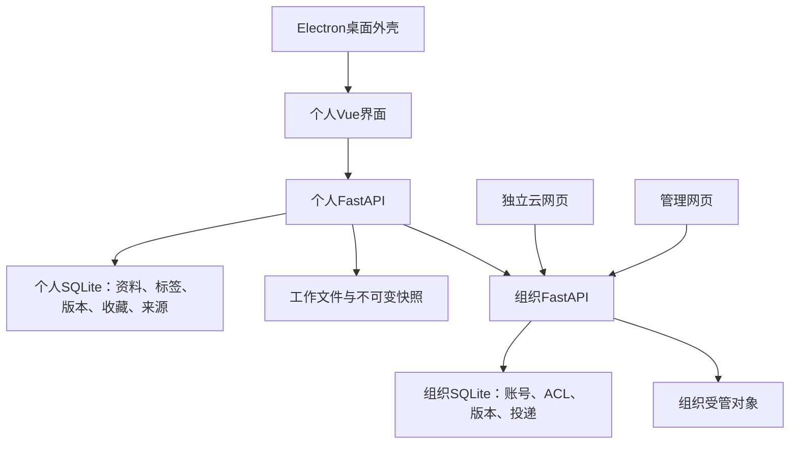

# TeamHub 代码审计与优化记录

日期：2026-10-07启动，2026-10-08完成。目标是在保持现有MVP功能、权限、版本及资料归属语义的前提下，梳理逻辑、减少重复查询和冗余实现，改善模块边界。文件及验收包沿用本轮启动日期命名。

## 1. 审计依据与范围

依据[项目基石](../product/TeamHub项目基石.md)、[云端与投递蓝图](../product/云端与资料投递实施蓝图.md)、现行代码及隔离运行证据。覆盖个人后端、云端后端、桌面/云网页/管理页、Electron外壳、启动与打包入口。

本轮开始时个人后端232项、云端98项测试通过，前端构建通过。工作区已有大量未提交成果，本轮按开始时源码副本记录差异，不将整个Git工作区差异计为本次修改。没有删除真实库、迁移历史、兼容数据库字段、用户依赖环境或试用资料。

## 2. 系统功能与代码关系



| 功能 | 入口及主要模块 | 必须保持的逻辑 |
| --- | --- | --- |
| 收录、整理、分类 | 个人documents API、snapshots、storage_paths、Pending/Library页面 | 接管对象处于待整理或文档库；拖入移动源文件，重复收录保留源；分类不改资料身份 |
| 标签、查找、收藏 | tags/documents/favorites API、资料查询响应服务 | 标签组合缩小范围；收藏和分类以已整理资料为前提；使用中的标签不能直接删除 |
| 本地版本 | versions API、versions/snapshots服务、详情抽屉 | 当前版本由指针确定；恢复直接切换历史并保护未保存修改；历史对象不可变 |
| 路径迁移与恢复 | settings API、storage_paths/storage_migration、backup | 只迁移登记归属对象；配置切换与文件变化有日志和补偿；不搬走未登记资料 |
| 桌面运行 | Electron主进程、preload、BackendManager | 主进程管理自有个人服务；动态端口、实例身份与退出清理；云端离线不影响个人整理 |
| 云账号与团队 | 个人sync代理、cloud_client；云端auth/web_auth、teams/workspaces | 个人凭据由个人后端维护；云网页同源会话；团队角色不能替代资料ACL |
| 共享和版本提交 | 个人sharing、ShareLink/RemoteOperation；云端publications/access/object_store | 主动选择范围；固定请求、哈希校验、过期基准冲突；管理员不默认读取受限资料 |
| 更新本地 | remote_update、VersionSource、工作文件与日志 | 固定远端版本、保护本地工作修改；观察版本和提交基准分离；重试不覆盖后续编辑 |
| 标签协作与回收 | 云端collaboration、个人共享页面/收藏 | 重读权限；本人贡献与管理权限分离；删除本地不删除共享资料 |
| 资料投递 | 双端deliveries API、固定附件引用、DeliveryPanel/Compose | 独立收件箱、明确收录才入待整理；撤回阻止新的附件取用，不删除已保存副本 |
| 运维与交付 | migrations/manage、backup、build-cloud/build-backend、launcher | 旧库显式升级；同服务恢复保留身份；独立包不携带个人库、凭据或真实数据库 |

## 3. 审计发现与优化原则

1. **查询规模与响应需求不匹配。** 标签逐项聚合；收藏逐项读取资料；列表为了显示当前版本而实体化全部历史。优先使用请求内批量读取及明确响应组装，不引入跨请求缓存造成失效问题。
2. **存在两套个人端云客户端。** 旧直连客户端读取已不再写入的浏览器令牌，而当前登录由个人后端负责，导致团队页面与登录状态脱节。统一到现有个人sync代理；独立云网页和管理员会话继续独立。
3. **旧代码仍暴露无调用通道。** Electron旧预签名URL下载、未使用的IPC白名单/端口等待器，以及部分后台辅助函数可以按引用证据移除。410兼容路由继续保留。
4. **文件操作有主线程阻塞及错误掩盖。** Electron目录判别/遍历原使用同步fs，读取失败被返回为空目录。改用异步文件系统，并将真实读取错误交给现有界面错误提示。
5. **部分容量显示不代表当前真实用量。** 配额执法统计组织历史版本和投递对象，管理页读取的旧storage_used列没有现行写入者；需统一计算口径，不能为了显示快而显示旧值。

优化不移除文件完整性校验，不擅自收窄事务锁，不更改权限矩阵或版本语义。移动期间的前后校验、接收恢复日志等看似重复的步骤承担不同失败保护职责。

## 4. 实施与量化结果

### 4.1 个人端

把个人资料响应抽到 `services/document_responses.py`，收藏不再反向依赖 documents 路由。标签批量统计、标签归一后去重、列表按当前版本指针批量读取。目录树在单次请求中只预取一次整体文件夹边界；写入时仍重新校验。

同一临时数据集：20份资料、每份10个版本、各一个标签和收藏，当前版本固定为第4版，验证不会误用最大版本号。

| 场景 | SELECT：优化前 → 后 | 加载版本实体：优化前 → 后 |
| --- | ---: | ---: |
| 标签列表 | 22 → 2 | 0 → 0 |
| 收藏列表 | 61 → 4 | 200 → 20 |
| 资料搜索 | 4 → 4 | 200 → 20 |
| 20分类目录及1个整体资料边界 | 44 → 1 | 0 → 0 |

同时修复：重复空白归一标签导致重复关联报错；创建标签尚未取得ID就写变更日志；登录额外请求已停用的设备注册端点。个人设备标识与现行云会话保留。

### 4.2 云端

`services/access.py` 按请求批量计算资料能力；搜索只加载当前版本、聚合版本数量；完整资料列表继续保留全部版本DTO。投递批量读取附件、发件人、本人回执和收件统计，收件人不能因此看到其他人的回执。团队及管理容量显示复用 `services/storage_usage.py` 的配额口径：全部保留的历史、回收站及已撤回投递均计入逻辑字节，不以物理去重字节代替。

云端独立样本：24份可见资料、每份12版，当前版本固定第5版；24条投递，发件箱命中23条。

| 场景 | SELECT：优化前 → 后 | 加载版本实体：优化前 → 后 |
| --- | ---: | ---: |
| 资料搜索 | 80 → 12 | 288 → 24 |
| 完整资料列表 | 101 → 9 | 288 → 288 |
| 收件箱 | 80 → 11 | 0 → 0 |
| 发件箱 | 99 → 11 | 0 → 0 |

以上衡量同样本数据库往返和实体加载，不能据此宣称端到端响应按相同比例提速，也不能替代并发压测。缓存只活在本次请求内，下一请求仍重读权限和角色。

### 4.3 桌面、前端及清理

- TeamPage、Onboarding统一经过个人sync代理，修复登录成功但团队操作使用另一套令牌的问题；创建团队后选中，成员请求过滤旧响应。
- 团队操作固定发起账号、服务地址及组件生命周期；auth store以会话/选择代次约束异步落状态，同代恢复请求复用，空间绑定串行处理。退出、切号、离页或切服务后旧操作不再继续改变当前选择。
- 引导页删除已停用的发现/加入审批流程，保留管理员邀请说明和创建团队/空间。分步创建失败后能继续已完成步骤。
- Electron目录查询和枚举使用异步文件系统；真实读取失败不再伪装为空目录。主窗口与悬浮窗共用逐项拖入入口，单个路径失败后继续处理其余路径。
- 端口探测等待测试服务器真正关闭再报告可用。前端资源复制失败明确使构建失败，不再吞掉错误。
- 删除无引用的旧个人端云客户端、旧个人收藏组件、令牌IPC/预签名下载IPC、端口等待器及后台辅助函数。删除清单、原文件摘要和保留项见[优化清理清单](优化清理清单-2026-10-07.json)。

未增加生产依赖或数据库迁移；保留410兼容路由和历史字段，没有将当前工作文件、历史快照或云端副本当成冗余内容删除。

按同一源码快照统计，`backend/app`、`cloud_backend/app`、`frontend/src`、`electron` 下的 `.py/.js/.vue/.css` 生产源码合计26193行变为25589行，净减少604行；不包含测试、文档、依赖或构建产物。云端服务模块因集中权限/容量查询增加代码，整体减少主要来自旧客户端、重复界面和无调用通道。

## 5. 验证与交付

使用临时数据库、受管文件及独立profile回归，沿用[系统级测试](MVP系统级测试报告-2026-10-05.md)的功能边界。

Python独立审查识别了目录预取只选两个字段而遗漏旧index路径分支的问题，已补全所需字段并添加HTTP回归。最终个人后端242项通过（原232 + 新增10），云端105项通过（原98 + 新增7）；启动器12项、Electron文件/端口/进程测试8项通过。Python复核已关闭问题。

JavaScript独立复核识别了悬浮窗异常中断、团队操作迟到响应污染新账号两项问题，现已修复；会话保护扩展至认证store。最终投递UI还发现首次加载服务地址被误判成切换服务，导致硬刷新跳登录，已区分首次设置加载与真实服务变化。原投递断言保持不变并复跑通过。

Python及JavaScript最终独立复核均通过，本轮发现的问题已关闭，无剩余阻塞项。未安装额外静态检查依赖；执行了可用JS语法检查、构建、差异空白检查及上述行为测试，不宣称运行过未配置的ruff/mypy/ESLint。

| 验证 | 本轮最终结果 | 本机日志（`/private/tmp/`） |
| --- | --- | --- |
| 个人后端全量 | 242 passed | `teamhub-audit-personal-final.log` |
| 云端后端全量 | 105 passed | `teamhub-cloud-query-full.log` |
| 启动器 | 12 passed | `teamhub-audit-launcher-final.log` |
| Electron文件/端口/生命周期 | 8 passed | `teamhub-audit-electron-final.log` |
| M2/M3/整理/导航/迁移桌面UI | 5组通过 | `teamhub-audit-{m2,m3,organize,library_navigation,storage_migration}-ui.log` |
| 共享/标签协作/投递桌面UI | 3组通过 | `teamhub-audit-{m4,m5,delivery}-ui.log` |
| 团队及个人会话UI | 15项检查通过，含5项确定性迟到响应和失效登录 | `teamhub-audit-team-ui.log` |
| 独立云网页完整/竞态 | 上传、权限、下载、投递、撤回及会话切换通过 | `teamhub-audit-cloud-web.log`、`teamhub-audit-cloud-races.log` |
| 前端/个人后端/桌面/云端构建 | 全部通过 | `teamhub-audit-team-build.log`、`teamhub-audit-backend-final-build.log`、`teamhub-audit-desktop-build.log`、`teamhub-audit-cloud-build.log` |
| 最终桌面实际产物 | file://、CSP、动态端口、持久化、主窗及悬浮窗原生拖入、异常后继续、退出回收通过 | `teamhub-audit-packaged.log` |
| 最终独立云端产物 | 清单哈希全覆盖、无真实库/凭据、独立初始化启动、服务身份、云/管理网页通过 | `teamhub-audit-cloud-package.log` |

本轮脚本证据均保存在本机临时目录。最后团队截图目录为 `teamhub-team-ui-kW6HmC`，投递为 `teamhub-delivery-ui-CL5RTV`，桌面包为 `teamhub-m6-packaged-9aJY5T`，独立云包为 `teamhub-cloud-package-cckl6r2h`；父目录是系统临时目录 `/var/folders/3_/z4lmy95j00b067x29p6ybkxr0000gn/T/`，可由上表日志找到完整路径。临时证据可能被系统清理，仓库测试脚本及此处结果用于复现。

本轮最终产物：

- 桌面：`dist-electron/audit-2026-10-07/mac-arm64/TeamHub.app`，macOS ARM64未签名测试包。
- 云端：`dist/teamhub-cloud.zip`，独立源代码及静态网页包。

检测到默认桌面包正在运行，因此没有覆盖 `dist-electron/mac-arm64/TeamHub.app` 或中断用户应用；根目录原一键启动入口仍指向该旧包。试用本轮优化需先退出旧应用，再打开上述 audit 目录的新包。若要更新原入口，退出旧应用后执行 README 中的正常桌面构建流程。打包验收使用独立临时库，未迁移、删除或重写真实用户资料。

新增量化测试可复现：

```sh
venv/bin/python -m pytest backend/tests/test_personal_read_efficiency.py -q -s
cloud_backend/venv/bin/python -m pytest cloud_backend/tests/test_query_efficiency.py -q --junitxml=/private/tmp/teamhub-cloud-query-efficiency.xml
node --test scripts/test_electron_file_access.cjs scripts/test_electron_ports.cjs scripts/test_m6_backend_manager.cjs
```

全量及界面测试沿用仓库隔离脚本，不使用用户真实库。构建仍提示大于500 kB的公共前端包；Python测试仍有依赖弃用和旧SQLAlchemy子查询写法警告，本轮没有靠关闭警告掩盖这些问题。

## 6. 后续仍需处理的边界

- 文件库扫描仍存在多次候选查找机会；应配合唯一候选、路径归属、符号链接及整体文件夹边界测试优化，不能只按文件名批量认领。
- 共享事务内的散列/归档校验会延长持锁时间；把它移出事务需要重新论证校验与文件使用间的竞态，不能直接删掉校验。
- 部分个人共享适配仍跨路由引用事务辅助函数。纯查询/DTO可先拆分；冻结请求、身份CAS和补偿逻辑应成组迁移，避免抽象后破坏边界。
- 云端同步ORM在async路由中执行、清理对象时的逐摘要引用查询，以及大型前端基础包仍有优化空间，需要各自的负载与正确性证据。
- 被停用路由过滤器屏蔽的旧注册/审批实现及部分辅助函数仍可进一步清理；本轮未重构其路由注册结构，未扩展到清除所有历史技术债。
- SQLite、macOS ARM64是当前验证范围；本轮不宣称已完成其他数据库、跨平台部署、大规模压测或长期多人生产验证。
